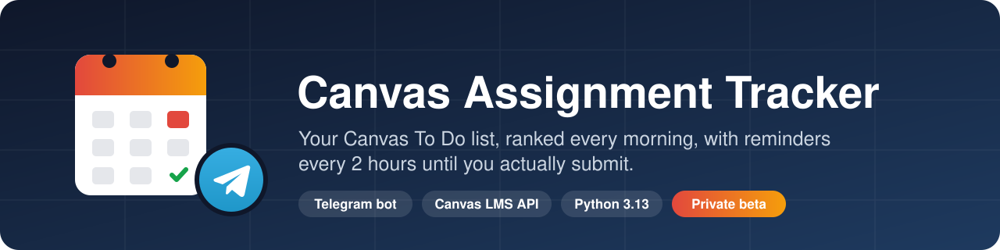
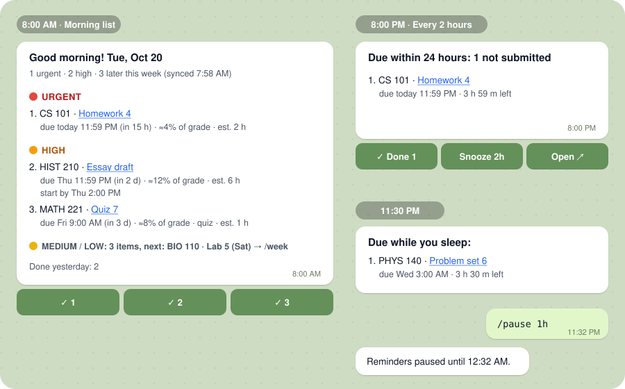
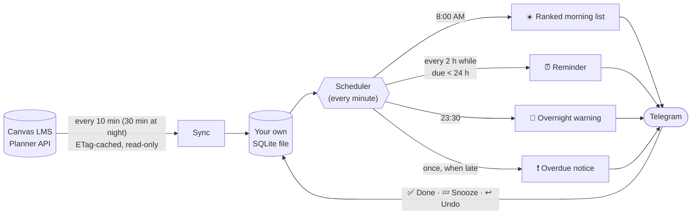
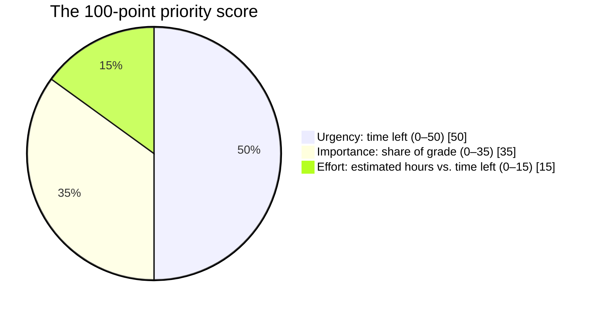
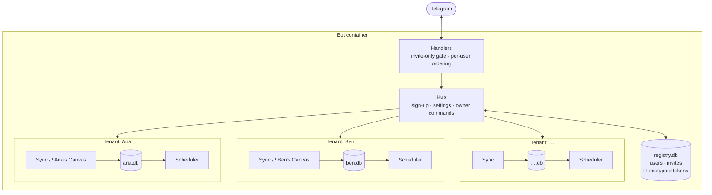

<p align="center">
  
</p>

<p align="center">
  <a href="https://github.com/rmaytr/CanvasAssignmentTrackingBot/actions/workflows/ci.yml"></a>
  
  
  
  <a href="LICENSE"></a>
  
</p>

<p align="center">
  
  
  
  
  
  
  
  
  
  <br>
  
  
  
  
  
  
  
  
</p>

<p align="center">
  <a href="#how-it-works">How it works</a> ·
  <a href="#get-started">Get started</a> ·
  <a href="#architecture">Architecture</a> ·
  <a href="docs/README.md">Documentation</a> ·
  <a href="CHANGELOG.md">Changelog</a>
</p>

---

Canvas tells you about a deadline once, in an email you probably didn't read. **This bot keeps telling you until the work is in.**

It reads your Canvas To Do list through the official API, sends you a **ranked list every morning**, and while anything is due within 24 hours it sends **one combined reminder every 2 hours, until Canvas shows it submitted** (each person can pick 1–4 hours, or no repeats). It runs as a Telegram bot: there's nothing to install, and the buttons work from your lock screen.

> **Private beta:** 6 students at several universities use it every day. A public release is planned. See the [roadmap](#roadmap).

<p align="center">
  
</p>

## Features

| | |
|---|---|
| ☀️ **Ranked morning list** | Everything due in the next 14 days (or 7 or 21, your choice), ranked by urgency, **share of your final grade** and estimated effort, with a one-line explanation for each item. It arrives at the time you choose, in your own time zone. |
| ⏰ **Reminders until submitted** | One combined message every 2 hours while anything is due within 24 hours. Each person picks their own rhythm in `/settings → ⏰ Reminders`: every 1, 2, 3 or 4 hours or no repeats, for work due within 12, 24 or 48 hours. Submitting in Canvas stops it automatically, usually within 10 minutes. |
| 📅 **No token? Use the calendar feed** | Schools that block access tokens (or people who'd rather not make one) can paste their private Canvas **calendar feed link** instead. Same morning list, reminders and events; since the feed can't see submissions, you tap ✅ Done when you hand something in. Switch any time in `/settings`. |
| ✅ **One-tap buttons** | **Done** for paper or in-class work Canvas can't see, **Snooze 2h**, **Open** in Canvas, and **Undo** within 10 minutes. |
| 🌙 **Respects your sleep** | Quiet hours you choose, an 11:30 PM warning about anything due overnight, and **one** overdue notice instead of endless nagging. |
| 🔒 **Private by design** | Read-only Canvas access, tokens and feed links encrypted at rest, your token or feed-link message deleted from the chat, invite-only access, and `/disconnect` erases everything. |
| 🧭 **Honest about stale data** | If Canvas can't be reached, every message says how old its data is. It never claims "nothing due" when it doesn't know. |

## How it works



**An item counts as done** when Canvas shows it submitted, graded (for paper or in-class work), excused or marked complete, or when you tap ✅ Done (in calendar-feed mode, only then). If its due date moves, an extension re-opens it automatically. **The ranking** is a transparent 100-point score:



The full rules, with a timeline of a real reminder day, are in **[How it works](docs/how-it-works.md)**.

## Get started

<table>
<tr>
<td width="50%" valign="top">

### 🎓 Join a bot (2 minutes)

You need an invite link from whoever runs the bot.

1. Tap the link and press **Start**.
2. Send your Canvas address (e.g. `school.instructure.com`).
3. Create a Canvas access token (the bot shows you how) and paste it. The bot deletes the message.
4. Pick your time zone, morning time and quiet hours.

**[Full guide for students →](docs/guides/joining.md)**

</td>
<td width="50%" valign="top">

### 🖥️ Host a bot for your friends (20 minutes)

You need a Telegram account and an always-on Linux server (Google Cloud's free tier works).

1. Create a bot with **@BotFather**.
2. On the server, run:
   ```sh
   curl -fsSL https://raw.githubusercontent.com/rmaytr/CanvasAssignmentTrackingBot/HEAD/deploy/install.sh | bash
   ```
3. Send the bot the `/start CODE` the installer prints.
4. Send `/invite` for each friend.

**[Full hosting guide →](docs/guides/hosting.md)**

</td>
</tr>
</table>

### Commands

| Command | What it does |
|---|---|
| `/today` · `/week` | What's due today, or in the next 7 days by priority |
| `/digest` | Your morning list, right now |
| `/sync` · `/status` | Check Canvas now · last sync, token health, next list and reminder, reminder rhythm, email, next event heads-up, latest announcement |
| `/pause 3h` | Pause reminders (`30m`, `until 18:00`, `off`) |
| `/settings` | Time zone, morning time, quiet hours, reminder rhythm, email, Canvas token, calendar feed or address |
| `/email you@gmail.com` | Also email the morning list and a heads-up 2 h before each deadline (`/email off` stops it) |
| `/feedback your message` | Send a note to the person who runs the bot (5 an hour) |
| `/disconnect` | Delete everything the bot knows about you |
| `/invite` · `/users` · `/remove N` · `/health` | *Owner only:* invite links, user health and email on/off (never anyone's assignments or address), removal, server health (uptime, disk, email, sync problems) |

## Architecture



- **Isolation by construction.** Every user gets their own database file, Canvas client and scheduler. Each Telegram update is routed by the sender's ID, so no code path can reach another user's data.
- **Functional core, imperative shell.** All scheduling and ranking is a pure function, `plan(now, snapshot, settings) → Plan`, with no I/O. That makes it simple to test exhaustively.
- **No duplicate messages.** Every message has a deterministic key, claimed atomically in SQLite before it's sent, so restarts, crashes and clock changes never send something twice.
- **Fault isolation.** Each user's tick runs on its own. One school's Canvas hanging never delays anyone else's reminders.

**[Architecture deep dive →](docs/architecture.md)** (components, data model, sign-up state machine, delivery guarantees, failure modes)

## Tech stack

| Area | Choice | Why |
|---|---|---|
| Language | **Python 3.13** (`asyncio`), strict typing | One process handles polling, scheduling and chat concurrently |
| Telegram | **python-telegram-bot 22** | Mature async library: inline keyboards, deep links, concurrent updates |
| HTTP | **httpx** | Async, timeouts, mockable transport for tests |
| Storage | **SQLite** (WAL), versioned SQL migrations | Zero-ops, a file per user, atomic claims with `UNIQUE` |
| Config | **Pydantic Settings** | Validated environment, secrets wrapped so they're never echoed |
| Crypto | **cryptography (Fernet)** | Authenticated encryption for stored Canvas tokens |
| Time | `zoneinfo` + `tzdata` | IANA zones, correct across daylight-saving changes |
| Packaging | **uv** (locked), Docker multi-stage build | Reproducible installs, small hardened image |
| Quality | pytest, Hypothesis, respx, time-machine, mypy `--strict`, Ruff (incl. Bandit rules), pip-audit | See [Testing](docs/testing.md) |
| CI/CD | GitHub Actions (SHA-pinned), Dependabot | Lint, types, tests on 3.13 and 3.14, coverage gates, audit, Docker build |
| Hosting | Docker Compose on a Debian/Ubuntu VM | Runs at $0 on Google Cloud's free tier |

## Quality at a glance

| | |
|---|---|
| **426** automated tests | Unit, property-based, integration, end-to-end and a 20-day minute-by-minute simulation |
| **94%** line + branch coverage | **98%** on the scheduling and ranking core (CI fails below 95%) |
| **0** `mypy --strict` errors | Across 106 source and test files |
| **18** review findings fixed | From two independent whole-codebase reviews, each with a regression test |
| **28,800** simulated scheduler ticks | Across a daylight-saving change, against a hand-reviewed golden file |

**[Testing strategy →](docs/testing.md)**

## Security

Canvas tokens are as powerful as a password, so the bot treats them that way:

- **Encrypted at rest:** Fernet (AES-128-CBC + HMAC-SHA256), with the key stored outside the data volume.
- **Never left in chat:** a message containing a token or a calendar feed link is deleted at whatever step it was pasted.
- **Never in logs:** known secrets and token-shaped strings are redacted from every log line, including exceptions.
- **Hardened Canvas client:** read-only (GET only), HTTPS on port 443, host-pinned with no redirects or cross-host pagination, and private or internal addresses refused.
- **Least-privilege container:** non-root, read-only filesystem, no Linux capabilities, file-based secrets.

**[Security policy and threat model →](SECURITY.md)**

### Canvas API policy

> [!IMPORTANT]
> Instructure's API policy says apps used by multiple people should use OAuth, and that asking other users to create and paste a personal token is not allowed. Token mode in the shared bot does exactly that, so it's run as a **small, invite-only private beta** among friends who understand the trade-off. **Calendar-feed mode** needs no token at all: it reads the same private calendar feed Canvas offers for Google or Apple Calendar, and is the recommended way to join someone else's bot. OAuth through participating schools is still on the [roadmap](#roadmap). Using your own token for your own data is the most defensible token setup; check your school's IT policy if you're unsure.

## Project layout

```text
├── src/canvas_tracker/
│   ├── domain/      # models, completion rule, 100-point priority score (pure)
│   ├── planning/    # scheduler: digest, reminder cycles, quiet hours, send keys (pure)
│   ├── render/      # message text, keyboards, 4096-char splitting, all user-facing copy
│   ├── sources/     # read-only Canvas REST client, Planner and enrichment mappers
│   ├── store/       # SQLite repository and migrations (one file per user)
│   ├── runtime/     # tick loop, sync scheduling, secret-redacting logs
│   ├── notify/      # Telegram and email (SMTP) delivery
│   ├── bot/         # per-user commands and buttons
│   └── hub/         # multi-user layer: registry, encryption, sign-up, routing
├── tests/           # unit · property · integration · simulation · contract
├── deploy/          # one-command server installer
├── spike/           # owner-run probes and a PII scrubber for real Canvas data
├── docs/            # guides, architecture, design records, research
├── Dockerfile · compose.yaml
└── pyproject.toml · uv.lock
```

## Roadmap

- [x] Single-user MVP: digest, reminders, buttons, quiet hours, Docker (**v0.1**)
- [x] Friends mode: shared invite-only bot, sign-up in chat, encrypted tokens, one-command install (**v0.2**)
- [ ] Beta feedback: tune ranking thresholds on real use; contract tests on scrubbed real Canvas data
- [ ] OAuth with participating schools and stronger protection for a public release (per-user key wrapping)
- [x] Hardening: rate limits on token checks and `/sync`, abandoned sign-ups free their slot, buttons tied to their database, Canvas host re-checked before each sync
- [x] Optional email: the morning list and a heads-up 2 hours before each deadline (any SMTP provider)
- [x] Per-user reminder rhythm: how often (or no repeats), how early reminders start, how far the morning list looks
- [x] Owner monitoring: ⚠️ alerts for failing syncs, failing email, a full disk or a stuck check; `/health`; an hourly summary log line
- [x] **Calendar-feed mode** for schools that block personal tokens (no token needed; you mark work done yourself)
- [ ] Localization (all copy already lives in one module)

## Documentation

| | |
|---|---|
| [Joining guide](docs/guides/joining.md) | For students using a bot someone invited them to |
| [Hosting guide](docs/guides/hosting.md) | Set up, run, update and back up your own bot |
| [How it works](docs/how-it-works.md) | Ranking, completion rule, reminder timeline, quiet hours |
| [Architecture](docs/architecture.md) | Components, data model, state machine, guarantees |
| [Testing](docs/testing.md) | Test layers, simulation, coverage, how to run |
| [Security](SECURITY.md) | Threat model, controls, reporting a vulnerability |
| [Design records](docs/design/) | Product requirements and the friends-mode design |
| [Background research](docs/research/background-research.md) | Canvas data access, channels, hosting and policy research |

## Contributing

Issues and pull requests are welcome. See **[CONTRIBUTING.md](CONTRIBUTING.md)** for setup (`uv sync`), the checks CI runs, and conventions. Please report security problems privately as described in [SECURITY.md](SECURITY.md).

## License

[Apache-2.0](LICENSE). Not affiliated with Instructure or Telegram. Canvas is a trademark of Instructure, Inc.

**Why Telegram and not SMS?** A bot has to rent a phone number and register with US carriers (about $20 up front plus $7–8 a month), and the free email-to-text gateways have shut down. Telegram is free, works on every phone and has buttons.
