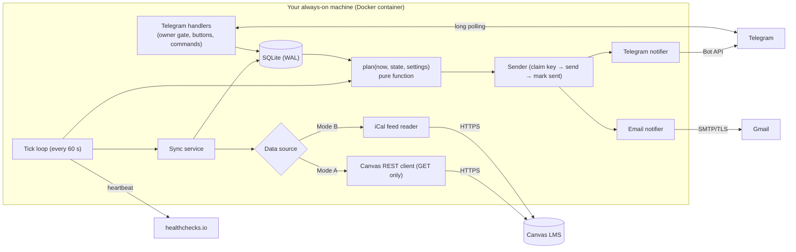

# Canvas Assignment Tracker Bot: Product Requirements Document

| | |
|---|---|
| **Status** | Draft v0.1, for review |
| **Date** | 2026-10-16 |
| **Owner** | [@rmaytr](https://github.com/rmaytr) |
| **Research behind it** | [`reports/Canvas assignment reminder bot.md`](../reports/Canvas%20assignment%20reminder%20bot.md) and its notes in [`research_notes/`](../research_notes/) |

Decisions in this document are tagged so you can tell where each one came from:

- **[Owner]**: something the owner asked for.
- **[Research]**: a choice the research supports, with the evidence in the report.
- **[Design call]**: a default picked while writing this PRD. It can be changed, and most are configurable.
- **[Open]**: still undecided. See [§17](#17-open-questions).

---

## 1. Summary

A self-hosted bot that reads a student's Canvas To Do list and keeps them on top of deadlines:

1. **Every morning at 8:00** (the owner's local time) it sends a ranked list of what's due, highest priority first. **[Owner]**
2. **When anything is due in under 24 hours** and hasn't been submitted, it sends a reminder **every 2 hours** until Canvas shows it submitted or the student taps **Done**. **[Owner]**
3. Messages arrive through a **Telegram bot** with **Done / Snooze / Open in Canvas** buttons. Email is a backup. **[Research]**

It reads Canvas through the **official Canvas API using the student's own access token**. This is the same request the Canvas To Do sidebar makes (`GET /api/v1/planner/items`). For schools that block student tokens, it falls back to the **Canvas calendar feed** plus a manual Done button. **[Research]**

It is a **single-user program each student runs for themselves**, published as open source on GitHub. It is never a hosted service that collects other students' tokens; Instructure's API policy forbids that. **[Research]**

The target running cost is **$0/month**. It runs on a Raspberry Pi, an always-on PC, or a free-tier cloud VM. **[Research]**

## 2. Problem and why now

- **Canvas has no "due soon" reminder.** Its "Due Date" notification fires when a due date is *created or changed*, not before a deadline. A request for automatic 24-hour reminders has been open as a Canvas Idea since 2018. The only built-in pre-deadline reminder is set by hand, per assignment and per device, in the Canvas Student phone app.
- **The To Do list only helps if you go and look at it.** Nothing pushes it to you, and it doesn't rank work by what matters.
- **Existing open-source tools fall short.** Of about 17 Canvas reminder and sync projects surveyed, none repeats reminders in the final 24 hours until the work is submitted. None has snooze or quiet hours, and almost none ranks work by its share of the final grade. Most are single-school, abandoned, or run on GitHub Actions cron, which is unreliable.
- **Access is getting harder.** Canvas now caps student tokens at a 120-day expiry, and a growing list of universities block student tokens entirely (UW–Madison, Ohio State, Texas A&M, the University of Missouri System). A tool that treats this as a first-class case keeps working where token-only tools stop.

## 3. Goals, non-goals, anti-goals

### Goals

| # | Goal |
|---|---|
| G1 | Never miss a deadline because the student forgot about it. |
| G2 | A digest that arrives on time, every day, and can be read in under 30 seconds. |
| G3 | Reminders in the last 24 hours that stop **promptly** once the work is submitted. |
| G4 | Correct across time zones, daylight-saving changes, restarts and outages: no duplicate messages, no silent gaps. |
| G5 | Secure enough to hold a password-equivalent token. Read-only toward Canvas. |
| G6 | Another student can set it up from the README in about 15 minutes, without writing code. |
| G7 | A public GitHub project with the security and quality practices expected of a real tool. |

### Non-goals (v1)

- A hosted multi-user service, web dashboard or mobile app.
- SMS delivery (see [§7.7](#77-email-and-other-channels)).
- Grades, feedback, instructor comments or assignment descriptions in any message.
- Syncing to Todoist, Notion or Google Calendar.
- Non-Canvas LMSs such as Moodle or Blackboard.
- Languages other than English for messages (the code should keep strings in one place so translation is possible later).

### Anti-goals (would make this a failure even if it "works")

- **Nagging about work that's already submitted.** One false nag teaches the student to ignore the bot.
- **Saying "nothing due" when the real cause is a failed sync.** Stale data must always be labelled as stale.
- **Duplicate or bursty messages**, for example after a restart or an outage.
- **Any write action on Canvas beyond "mark as done"**, such as submitting, messaging or editing. The bot must never be able to act as the student.
- **Leaking a token** through logs, error messages, the repo, cassettes or the container image.
- **Breaking school policy**, such as collecting other people's tokens or scraping where an official API exists.

## 4. Users

| User | Description | What they need |
|---|---|---|
| **Owner (primary)** | The student who runs the bot on their own machine for their own Canvas account. | Reliable digests and reminders, quick buttons, near-zero maintenance. |
| **Self-hoster (secondary, after v1.0)** | Another student who finds the repo on GitHub and runs their own copy. Comfortable following a guide, may not code. | Clear setup docs, Docker, sensible defaults, a check for whether their school allows tokens. |
| **Contributor** | A developer sending pull requests. | Clean architecture, fast tests, clear CONTRIBUTING and SECURITY docs. |

## 5. User stories

| ID | As a student, I want to… | So that… |
|---|---|---|
| US1 | get one message at 8:00 with everything due in the next two weeks, most important first | I know what to work on today without opening Canvas. |
| US2 | be reminded every 2 hours once something is due within 24 hours | I can't forget it on the last day. |
| US3 | have reminders stop by themselves once I submit | I'm not nagged for finished work. |
| US4 | tap **Done** for work Canvas can't see (paper, in-class, external tools) | reminders stop for those too. |
| US5 | tap **Snooze 2h** | I can get through a class or a shift without being pinged. |
| US6 | not be woken up at night | the bot respects my sleep but still warns me about overnight deadlines first. |
| US7 | see why something is ranked high ("≈12% of grade, due in 5 h") | I trust the ranking. |
| US8 | be told clearly when the bot can't reach Canvas or my token is about to expire | I'm never misled by an empty list. |
| US9 | ask the bot "what's due today / this week?" at any time | I can check on demand. |
| US10 | pause all reminders for a few hours, for example during an exam | I'm not distracted. |

---

## 6. Key decisions at a glance

| Area | Decision | Tag |
|---|---|---|
| Data source, primary (Mode A) | Canvas REST `GET /api/v1/planner/items` with the student's personal access token | [Research] |
| Data source, fallback (Mode B) | Canvas calendar (iCal) feed + manual Done | [Research] |
| Session-cookie scraping (Mode C) | Not in v1. Maybe later as an off-by-default experimental mode. | [Research] |
| Screenshots / OCR (Mode E) | Not in v1. Maybe a later "paste a screenshot" helper using local OCR only. | [Research] / [Design call] |
| Primary channel | Telegram bot, long polling, HTML formatting, owner-only | [Research] |
| Backup channel | Email over Gmail SMTP with an App Password: a digest copy and failure alerts | [Research] |
| SMS | Out of scope, documented in the README | [Research] |
| Digest time | 08:00 local, configurable | [Owner] |
| Reminder rule | Every 2 h while any not-done item is due in < 24 h, combined into **one** message per cycle | [Owner] + [Research] |
| Quiet hours | Default 00:00–08:00, with a "due overnight" warning before they start | [Research] / [Open] Q4 |
| After the deadline | One "now overdue" notice, then digest only. Continued 2-hour reminders are opt-in. | [Research] / [Open] Q3 |
| Prioritization | Transparent 100-point score (urgency + importance + effort) → URGENT / HIGH / MEDIUM / LOW | [Research] |
| Language and runtime | Python 3.13+, asyncio, single process | [Research] |
| Libraries | python-telegram-bot 22.x, httpx (small custom Canvas client), pydantic-settings, zoneinfo + tzdata, stdlib sqlite3 | [Research] / [Design call] |
| Storage | SQLite in WAL mode on a local volume | [Research] |
| Scheduling | One idempotent tick loop (no per-reminder jobs, no GitHub Actions cron) | [Research] |
| Hosting | Docker Compose on a Pi, home PC, Oracle Always Free, GCP e2-micro, or a ~€5 VPS | [Research] / [Open] Q2 |
| Monitoring | healthchecks.io heartbeat + `/status` command | [Research] |
| License | Apache-2.0 | [Research] |

---

## 7. Functional requirements

### 7.1 Data access

#### Mode A: Canvas API with a personal access token (primary)

The student creates a token in Canvas under **Account → Settings → "+ New Access Token"**, giving it a purpose such as "Assignment reminder bot" and an expiry of at most 120 days.

**Requests** (all `GET`, sequential, never in parallel):

| Purpose | Request | When |
|---|---|---|
| To Do items with per-student due dates and submission state | `GET /api/v1/planner/items?start_date={now−28d}&end_date={now+21d}&per_page=100` (no `filter`, so done items come back too and "done" is explicit, not inferred from absence) | Every sync |
| Active courses | `GET /api/v1/courses?enrollment_state=active&per_page=100` | Every enrichment |
| Points, submission types, assignment group, `lock_at`, undated work | `GET /api/v1/courses/:id/assignments?include[]=submission&per_page=100` and `…&bucket=undated` | Every enrichment |
| Group weights for "% of grade" | `GET /api/v1/courses/:id/assignment_groups`, plus the course's `apply_assignment_group_weights` (or one GraphQL query; the builder picks after the spike, see §15 M0) | Every enrichment |
| Past-due work still owed | `GET /api/v1/users/self/missing_submissions?filter[]=submittable` | Every enrichment |
| Token check | `GET /api/v1/users/self` | Startup and after auth errors |

**Cadence** [Design call, from research ranges]:

- **Sync** (planner only): every **10 min** outside quiet hours and every **30 min** during quiet hours. Also **right before any digest or reminder** if the last successful sync is more than 5 minutes old, with a 30-second timeout.
- **Enrichment** (courses, assignments, groups, missing): every **12 h**, at startup, and whenever a sync sees an unknown course or assignment.
- Use `If-None-Match` with the stored ETag on planner requests; a `304` counts as a successful sync.

**Protocol rules** (must):

- Send `User-Agent: CanvasAssignmentTrackingBot/<version> (+https://github.com/rmaytr/CanvasAssignmentTrackingBot)`. Canvas has rejected requests without a User-Agent since 2026-06-20.
- Follow pagination only through the `Link: rel="next"` header, and only if the next URL's scheme and host exactly match the configured Canvas host.
- Never follow HTTP redirects while the token is attached.
- Parse all timestamps as ISO 8601. Accept both `Z` and `±HH:MM` offsets, convert to UTC immediately, and never store naive datetimes.
- Treat both **429** and **403 whose body says "Rate Limit Exceeded"** as throttling.
- A **401** (especially with `WWW-Authenticate`) means the token is invalid or expired. Stop calling Canvas and alert the owner ([§7.9](#79-health-errors-and-alerts)).

**Token lifecycle:**

- Store the token's expiry date. Read it from the API if possible ([§17](#17-open-questions), spike item S3), otherwise from the `CANVAS_TOKEN_EXPIRES_AT` setting.
- Warn on Telegram **14, 7, 3 and 1 days** before expiry, with renewal steps.
- Re-read the token secret file at the next sync after an auth failure, so updating the token needs no restart.

#### Mode B: calendar feed (fallback when tokens are blocked)

The student copies the feed link from **Canvas → Calendar → Calendar Feed**. No token is needed.

- Fetch the `.ics` directly every **30 min** (not through Google Calendar, which can lag about 24 hours). Use conditional requests if the server supports them.
- Map events whose `UID` looks like `event-assignment-<id>` to assignment items, keyed by that ID. `SUMMARY` contains the course code; `DTSTART` holds the due time. All-day events need checking in the spike (S1); default: treat them as due at 23:59 local on that date.
- Detect new items and due-date changes by comparing `UID`s between downloads.
- **There is no submission status.** An item is done only when the student taps **Done**. If the spike shows that submitted assignments really drop out of the feed, a disappearance can also count as done, behind a setting.
- No points or weights are available, so importance comes from keywords only ([§7.3](#73-prioritization)).
- Treat the feed URL as a secret, the same as a token.

#### Modes considered and left out of v1

| Mode | Why it's not in v1 |
|---|---|
| **C. Reusing the browser session cookie** to call the same JSON API | Arguably works around a school's token ban. SSO and Duo sessions expire, so it can't run unattended. Revisit later as an experimental, off-by-default mode with a "check with IT first" warning. |
| **D. Parsing Canvas notification emails** | Canvas emails announce date *changes*, not upcoming deadlines, so they can't drive reminders. |
| **E. Screenshots + OCR or a vision model** (the owner's "another bot sends screenshots" idea) | Most brittle: no stable IDs, the sidebar shows 14 items at a time, and dates are hard to read reliably. Sending screenshots to a hosted vision model hands course data to a third party. A later "paste a screenshot" helper could use **local** OCR only. |

### 7.2 The item model and when an item counts as "done"

Each Canvas item is stored under a stable key `(plannable_type, plannable_id)`, never its title, because titles change and title keys create duplicates.

| Field | Source |
|---|---|
| `title`, `course_id`, `course_code`, `course_name`, `html_url` | planner item / course |
| `type` | `assignment`, `quiz`, `discussion_topic`, `sub_assignment` (checkpoint), `assessment_request` / `peer_review_sub_assignment` (peer review), `wiki_page`, `planner_note`, `calendar_event` |
| `due_at_utc` | `plannable_date` (already adjusted for this student's section and individual overrides) |
| `lock_at_utc` | assignment `lock_at` ("available until"), from enrichment |
| `points_possible`, `submission_types`, `assignment_group_id`, `omit_from_final_grade` | enrichment |
| `submitted`, `excused`, `graded`, `late`, `missing`, `redo_request`, `marked_complete` | planner `submissions` + `planner_override` |
| `bot_done_at`, `snoozed_until`, `stop_reminders` | the student's actions in Telegram |
| `first_seen_at`, `last_seen_at`, `gone_at` | sync bookkeeping |

**Done rule** [Research]. An item is **done** if any of these is true, checked in order:

| # | Condition | `done_source` |
|---|---|---|
| 1 | `redo_request = true` → **not done**, whatever else is true (the teacher re-opened it) | none |
| 2 | `marked_complete = true` (the student checked it off in Canvas) | `canvas_marked` |
| 3 | `submitted = true` | `submitted` |
| 4 | `excused = true` (Canvas still counts this as incomplete; the bot doesn't) | `excused` |
| 5 | `graded = true` **and** every submission type is offline (`on_paper`, `none`, `external_tool`) | `graded_offline` |
| 6 | The student tapped **Done** in the bot (`bot_done_at` set) and the item's `due_at` hasn't changed since | `bot` |

Rules that come with it:

- **A teacher-entered zero on online work does not make it done.** The item stays in the **Overdue** section while Canvas still accepts submissions. A popular existing tool hid such work by mistake.
- Never use `has_submitted_submissions`: it is true if *any* student in the course submitted.
- Items with no submission concept (planner notes, ungraded pages or discussions with a to-do date) are done only through rule 2 or rule 6.
- `calendar_event` items appear in the digest under "Events" and **never** get reminders.
- If an item stops appearing in Canvas results while its date is still inside the window (deleted or unpublished), set `gone_at`, stop reminders, and leave it out of the digest.
- If `due_at` changes (an extension), clear `bot_done_at`, `snoozed_until` and `stop_reminders`, and treat it as a new deadline.

### 7.3 Prioritization

A transparent score out of 100, as described in the research report. All thresholds live in one configuration object so they can be tuned later. [Research; the thresholds themselves are design calls]

| Component | Points | Rule |
|---|---|---|
| **Urgency U** | 0–50 | Overdue and still accepted: 50 · ≤24 h: 45 · ≤48 h: 35 · ≤72 h: 25 · ≤7 days: 12 · later: 4 |
| **Importance I** | 0–35 | Share of final grade ≥15%: 35 · ≥8%: 28 · ≥4%: 20 · ≥1.5%: 12 · >0: 6 · ungraded or 0 points: 2. Add 5 if the title or type matches exam, midterm, final or project (cap 35). |
| **Effort pressure E** | 0–15 | `slack = hours_left − 1.5 × estimated_effort_h`. Slack ≤0: 15 · ≤24 h: 10 · ≤72 h: 5 · otherwise 0 |

- **Share of final grade:** in weighted courses, `group_weight% × points_possible / Σ points of non-omitted items in that group`. In unweighted courses, `points_possible / Σ points of non-omitted items in the course`. If it can't be computed (as in Mode B), show "weight unknown" and use I = 6 for graded types, 2 otherwise.
- **Default effort estimates (hours):** discussion, quiz or reading 1 · homework or other assignment 2 · lab 3 · essay or project 6 · exam prep 8. They are picked by type and title keywords. Per-item overrides come in v1.1.
- **Tiers:**
  - **URGENT**: not done, and due in ≤24 h or overdue but still accepted. Only pre-deadline URGENT items get 2-hour reminders.
  - **HIGH**: score ≥55, or due ≤72 h and ≥8% of the grade, or due ≤7 days and ≥10% of the grade, or slack <24 h.
  - **MEDIUM**: score 30–54.
  - **LOW**: score <30.
- **Order within a tier:** due time first, then score, then course code.
- **Each line explains its rank**, for example `due in 5 h 20 m (Tue 11:59 PM) · ≈12% of grade · quiz · est. 1 h`. HIGH items add `start by <due − 1.5×effort, rounded down to the hour>`.

### 7.4 Daily digest

**When:** every day at `DIGEST_TIME` (default 08:00) in `TIMEZONE`. [Owner]

- The **send key** is `digest:{local_date}`, so each local date gets at most one digest. Daylight-saving changes and restarts are handled by this key alone. 08:00 never falls inside a clock change, which happens around 00:00–03:00.
- **Grace window:** if the bot was down at 08:00, it still sends until `DIGEST_GRACE_UNTIL` (default 12:00). After that the day's digest is skipped, and `/digest` can still send it on request. [Design call]
- **Sync first:** if the last successful sync is more than 5 minutes old, sync with a 30-second timeout. If that fails, send anyway with a stale-data banner.
- **The digest is the first message after quiet hours.** It replaces any reminder slot that falls at the same moment, so the student doesn't get two messages at 08:00.

**Content**, in order:

1. Header: date, tier counts, and "synced HH:MM". If data is stale: `⚠️ Couldn't reach Canvas since HH:MM, so this list may be out of date.`
2. 🔴 **URGENT**: every item, with buttons.
3. 🟠 **HIGH**: every item, with buttons.
4. 🟡 **MEDIUM** and ⚪ **LOW**: collapsed to a count plus the next three due, then "→ /week".
5. ⚠️ **Overdue / missing**: still accepted (before `lock_at`), at most 7 days past due.
6. 📅 **Events today**: calendar events.
7. ✅ **Done yesterday**: a count.

The look-ahead is 14 days. If nothing is due: `Nothing due in the next 14 days 🎉 (synced 07:58)`, but only when the last sync succeeded. Otherwise the stale banner wins.

**Example** (Telegram, HTML formatting; titles become links to Canvas):

```text
☀️ Good morning! Tue, Oct 20
3 urgent · 1 high · 4 later this week (synced 7:58 AM)

🔴 URGENT
1. CS 101 · Homework 4: Recursion
   due today 11:59 PM (in 15 h) · ≈6% of grade · est. 2 h
2. MATH 221 · Quiz 7
   due today 2:00 PM (in 6 h) · ≈2% · quiz · est. 1 h
3. ENG 105 · Peer review: Essay 2
   due today 11:59 PM (in 15 h) · peer review

🟠 HIGH
4. PHYS 150 · Lab report 3
   due Thu 11:59 PM (in 2 d) · ≈8% · est. 3 h · start by Thu 6 PM

🟡 MEDIUM / ⚪ LOW: 4 items, next: HIST 110 Reading 6 (Fri) → /week

⚠️ OVERDUE
• HIST 110 · Reading response 5: was due Sun, still accepted until Fri

✅ Done yesterday: 2
[✅ 1] [✅ 2] [✅ 3] [✅ 4]
```

**Splitting:** Telegram messages are limited to 4,096 characters. Split long digests at item boundaries, never inside an HTML tag, and number the parts (1/2, 2/2).

**Email copy:** if `EMAIL_DIGEST=true`, send the same digest as an HTML + plain-text email.

### 7.5 Due-soon reminders

This is the core feature. [Owner]: "when it's less than 24 hours left… every 2 hours until the assignment is done."

**Definitions** (all reminder timing uses UTC durations, never wall-clock slots):

- An item is **urgent** when it is not done, not `gone`, its type can get reminders (not `calendar_event`), and `0 < due_at − now ≤ REMINDER_WINDOW` (default 24 h).
- An item is **active** when it is urgent, not snoozed (`snoozed_until ≤ now`), not `stop_reminders`, and reminders aren't paused.

**Cycle model** (one combined message, not one message per item) [Research]:

1. When the first urgent item appears and no cycle is open, open a cycle with `anchor = now`, truncated to the minute.
2. **Slot k** is due at `anchor + k × REMINDER_INTERVAL` (default 2 h), for k = 0, 1, 2, …
3. At each slot, if the time is outside quiet hours and at least one item is active, send **one** message listing every active item, under the send key `rem:{anchor_iso}:{k}`.
4. **Catch-up:** if the bot was down and missed slots, send only the **latest** slot that's due, and only if it's less than 30 minutes late. Older missed slots are skipped silently. Never send a burst.
5. A slot that falls inside quiet hours is skipped, not delayed. A slot within 15 minutes of the digest is folded into the digest.
6. The cycle closes when no urgent items remain. The next urgent item opens a new cycle.

**Edge rules:**

| Situation | Behavior | Tag |
|---|---|---|
| A new item becomes urgent mid-cycle | It joins the next slot. If the next slot is at or after its deadline, send an immediate single-item alert `new:{item}:{due_at}`. | [Research] |
| A new item appears with < 2 h left (last-minute posting) | Immediate alert, as above. | [Research] |
| The student submits, or taps Done | Gone from the next slot. The pre-send sync keeps the "already submitted, still nagged" window to one poll interval or less. | [Research] |
| Snooze 2h | `snoozed_until = min(now + 2 h, due_at − 30 min)`. When a snooze ends and the item is still urgent, send a single-item reminder `snz:{item}:{snoozed_until}`, so snoozing never swallows the last 30 minutes. | [Design call] |
| Due date extended | Clear the item's done, snooze and stop state; it re-enters the rule against the new `due_at`. | [Research] |
| **Due overnight** | At `QUIET_START − 30 min` (default 23:30), if any not-done item is due before `QUIET_END`, send one warning `overnight:{local_date}`: "Due while you sleep: …". | [Research] |
| **Deadline passes, not done** | Send one "now overdue" notice `overdue:{item}:{due_at}` (during quiet hours it waits for the digest). Then the item is digest-only, under Overdue. | [Research] / [Open] Q3 |
| `OVERDUE_REMINDERS=true` (opt-in) | After the deadline, keep the 2-hour cadence while Canvas still accepts the work (`lock_at` empty or in the future), for at most `OVERDUE_REMINDER_MAX` (default 48 h). The student can stop it with 🔕. | [Design call] |
| Pause (`/pause 3h`) | Reminders and alerts are muted. The digest still goes out. When the pause ends, the next due slot fires normally. | [Design call] |

**Worked example.** Defaults: quiet hours 00:00–08:00, digest at 08:00. One assignment due Tue 23:59, never submitted.

- Mon 23:59: the item becomes urgent and the cycle opens (anchor Mon 23:59). Slot 0 fires at 23:59, just before quiet hours.
- Tue 01:59 / 03:59 / 05:59 / 07:59: inside quiet hours, so skipped. (07:59 would be folded into the 08:00 digest anyway.)
- Tue 08:00: the digest lists it under URGENT.
- Tue 09:59, 11:59, 13:59, 15:59, 17:59, 19:59, 21:59: reminders. 23:30: no overnight warning, because nothing is due between 00:00 and 08:00.
- Tue 23:59: deadline passes → one "now overdue" notice. That's about 8 reminders plus the digest, instead of 12 overnight pings.

**Reminder message example:**

```text
⏰ Due within 24 hours: 2 not submitted

1. CS 101 · Homework 4: Recursion
   due 11:59 PM · 9 h 58 m left
2. MATH 221 · Quiz 7
   due 2:00 PM · 1 h 58 m left ⚠️

[✅ Done 1] [💤 2h 1] [🔗 1]
[✅ Done 2] [💤 2h 2] [🔗 2]
```

Wording rotates among a few templates, and the closest deadline goes first, because identical repeated messages get tuned out. [Research]

### 7.6 Telegram bot

**Setup and pairing** [Design call]:

- The owner creates a bot with @BotFather and puts its token in the bot's secret file.
- If `TELEGRAM_OWNER_ID` is set, only that user ID is accepted.
- Otherwise the bot runs in **pairing mode**:
  - At startup it logs a one-time 8-character code that expires after 15 minutes.
  - The first private-chat user who sends `/start <code>` becomes the owner, saved in the database.
  - After 5 wrong attempts the code is invalidated and a new one is logged.
- After pairing, the owner can only be changed by clearing the stored owner and restarting.

**Owner gate** [Research] (must):

- A handler that runs before all others drops every update whose user isn't the owner or whose chat isn't private.
- Dropped updates get no reply at all, so strangers learn nothing.

**Transport:**

- Use **long polling** (`getUpdates`). It needs only outbound connections: no open ports and no public URL. [Research]
- Webhooks are out of v1. If they are ever added, they must check the `secret_token` header in constant time.

**Formatting:**

- Use **HTML formatting** only.
- Escape every value that comes from Canvas (`&`, `<`, `>`, and `"` inside attributes).
- Emit links only when the URL is `https` and its host is the configured Canvas host.
- Never forward assignment descriptions.

**Buttons** (inline keyboard; `callback_data` ≤ 64 bytes, for example `d:<item_ref>`, `s:<item_ref>`, `u:<item_ref>`, `x:<item_ref>`; `item_ref` is a short database ID, never a Canvas URL):

| Button | Effect |
|---|---|
| ✅ Done | Sets `bot_done_at`, edits the message to show the item ticked, and adds a ↩️ Undo button for 10 minutes. If `SYNC_DONE_TO_CANVAS=true`, it also marks the item complete in the Canvas Planner (`POST /api/v1/planner/overrides` with `marked_complete: true`; the only write allowed). |
| 💤 2h | Snooze ([§7.5](#75-due-soon-reminders)). |
| 🔗 Open | A URL button to the item's `html_url`. |
| 🔕 Stop | Only on overdue notices: sets `stop_reminders`. |
| ↩️ Undo | Reverses Done or Stop. |

Every button press is answered within a few seconds, so the button doesn't keep spinning. A press on a stale button (an item already gone) answers "That item is no longer on your list."

**Commands** (v1):

| Command | Does |
|---|---|
| `/start [code]` | Pairs with the owner, or shows a welcome and a summary of the settings |
| `/help` | Lists commands |
| `/today` | Items due today plus anything URGENT or overdue |
| `/week` | The next 7 days, grouped by tier |
| `/digest` | Sends today's digest now (doesn't change the schedule or the send keys) |
| `/sync` | Syncs now, then reports `✓ synced 12 items` or the error |
| `/status` | Last successful sync, data mode, token expiry, next digest, next reminder slot, pause state, version |
| `/pause <30m\|3h\|until 18:00\|off>` | Pauses reminders |

Planned for v1.1: `/mute <course>`, `/settings` for editing settings in the bot, and a ⏱ button to set an effort estimate.

### 7.7 Email and other channels

**Email (v1, optional):**

- SMTP over TLS: port 465 with implicit TLS, or 587 with STARTTLS. The defaults target Gmail with an **App Password**, which needs 2-Step Verification.
- Recommend a **separate sending account**, because an App Password opens the whole mailbox.
- Uses:
  - a digest copy (`EMAIL_DIGEST=true`)
  - **fallback alerts**: if Telegram sends fail for more than 15 minutes, send critical messages by email (token problems, Canvas unreachable, and reminders while Telegram is down)
  - "Telegram is unreachable" alerts.
- Never send the 2-hour reminders by email by default.
- Remove CR/LF from header values, and escape HTML bodies automatically.

**SMS: out of scope.** The README explains why, answering the owner's question directly:

- A bot can't text from nowhere. It has to rent a phone number from a provider such as Twilio.
- In the US, carriers have required paid "10DLC" registration since February 2025: about $19.50 up front plus about $7–8 a month, and 1–3 weeks of paperwork.
- The free email-to-text addresses have shut down: AT&T in 2025, T-Mobile in late 2024, and Verizon by March 2027.
- Telegram is free and does more, including buttons.

**Later (v1.x), behind a `Notifier` interface:**

- ntfy: free and open source; on the public server the topic name must be a long random string.
- Pushover: $4.99 once; an optional "emergency priority" for the final hours, which repeats until acknowledged.
- Apprise, to fan messages out to other services. It is one-way only, so it has no buttons.
- Discord DM bot.

### 7.8 Configuration

Configuration comes from environment variables, loaded and validated by pydantic-settings at startup. The program fails fast with a readable error on a bad value. Every secret also accepts a `*_FILE` variant pointing to a file, which is the recommended way. Runtime state changed through the bot (owner ID after pairing, pauses, snoozes) lives in the database. **The database never contains secrets.**

| Variable | Default | Notes |
|---|---|---|
| `DATA_MODE` | `api` | `api` (Mode A) or `ical` (Mode B) |
| `CANVAS_BASE_URL` | required for `api` | e.g. `https://canvas.school.edu`. HTTPS only; no user info, path, query or raw IP. |
| `CANVAS_TOKEN` / `CANVAS_TOKEN_FILE` | required for `api` | Secret |
| `CANVAS_TOKEN_EXPIRES_AT` | none | ISO date, used if the API can't report expiry |
| `CANVAS_ICAL_URL` / `CANVAS_ICAL_URL_FILE` | required for `ical` | Secret. HTTPS only. |
| `TELEGRAM_BOT_TOKEN` / `_FILE` | required | Secret |
| `TELEGRAM_OWNER_ID` | none (pairing mode) | Numeric Telegram user ID |
| `TIMEZONE` | required | IANA name, e.g. `America/Chicago`. A Canvas profile default may come later (spike S4). |
| `DIGEST_TIME` | `08:00` | Local time |
| `DIGEST_GRACE_UNTIL` | `12:00` | Local time |
| `DIGEST_LOOKAHEAD_DAYS` | `14` | |
| `REMINDER_WINDOW_HOURS` | `24` | |
| `REMINDER_INTERVAL_MINUTES` | `120` | Minimum 30 |
| `QUIET_HOURS` | `00:00-08:00` | `off` disables quiet hours |
| `OVERDUE_REMINDERS` | `false` | See [§7.5](#75-due-soon-reminders) |
| `OVERDUE_REMINDER_MAX_HOURS` | `48` | |
| `SYNC_DONE_TO_CANVAS` | `false` | Allows the single planner-override write |
| `HIDE_COURSES` | empty | Comma-separated course IDs or codes |
| `EMAIL_ENABLED`, `SMTP_HOST`, `SMTP_PORT`, `SMTP_USER`, `SMTP_PASSWORD` / `_FILE`, `EMAIL_TO`, `EMAIL_DIGEST` | off | |
| `HEALTHCHECK_PING_URL` / `_FILE` | none | healthchecks.io ping URL (secret) |
| `DB_PATH` | `/data/bot.db` | Must be a local disk, not a network share |
| `ITEM_RETENTION_DAYS` | `30` | Purge items this many days after they are due |
| `LOG_LEVEL` | `INFO` | |

### 7.9 Health, errors and alerts

| Event | Bot behavior | Student sees |
|---|---|---|
| Canvas 429 / 403 throttling, 5xx, timeout | Retry up to 4 times with capped exponential backoff and full jitter, `sleep = random(0, min(60 s, 2 s × 2^attempt))` | Nothing, unless it persists |
| No successful sync for **60 min** outside quiet hours | Circuit breaker opens: retry every 15 min, keep using the last known state marked stale | One alert: "Can't reach Canvas since HH:MM", then one "✓ Back in sync" when it recovers |
| Canvas 401 | Stop Canvas calls; recheck when the secret file changes, on `/sync`, or every 6 h | One alert with token-renewal steps (and email if enabled) |
| Token expiring | — | Warnings at 14/7/3/1 days |
| Telegram 429 | Wait `retry_after` seconds, then retry | Nothing |
| Telegram unreachable for more than 15 min | Fall back to email if configured | Email alert |
| Host down, process crashed or stalled | The heartbeat stops arriving | healthchecks.io emails the student |

**Heartbeat:**

- Ping `HEALTHCHECK_PING_URL` after each successful sync. Recommended check settings: period 15 min, grace 30 min.
- Ping `/fail` on a 401.

**Container health check:** it reads `last_tick_at` from the database and is unhealthy if that is more than 3 minutes old. It never calls Canvas.

**Logs:**

- JSON lines to stdout.
- Item titles appear only at DEBUG level; INFO logs carry item IDs.
- Secrets never appear ([§10](#10-security-and-privacy)).

---

## 8. Non-functional requirements

| ID | Requirement | Target |
|---|---|---|
| NFR1 | Digest punctuality | Sent between 08:00:00 and 08:05:00 local on ≥99% of days the host was up at 08:00 |
| NFR2 | Exactly-once sends | Each send key is sent at most once. After a crash between sending and recording, at most one duplicate per crash. |
| NFR3 | Submission detection | p95 ≤ 15 min outside quiet hours. A reminder never goes out based on a sync more than 5 minutes old, unless it's labelled stale. |
| NFR4 | Reminder punctuality | A slot fires within 90 s of its time while the host is up |
| NFR5 | Resource use | ≤100 MB RAM, near-zero idle CPU; runs on a Raspberry Pi 3 or later and on a 1 GB VM |
| NFR6 | Canvas load | One request in flight at most; about 150 requests a day or fewer in Mode A |
| NFR7 | Setup time | A new self-hoster gets a first digest within 15 minutes of following the README (measured in a usability test before v1.0) |
| NFR8 | Portability | `linux/amd64` and `linux/arm64` images; also runs with `uv run` without Docker |
| NFR9 | Time correctness | All stored times are UTC. All local rendering uses `zoneinfo` with the bundled `tzdata`. Naive datetimes are banned by lint. |
| NFR10 | Maintainability | Core logic (`domain/`, `planning/`) has no I/O and no direct clock reads |

---

## 9. Architecture

### 9.1 Overview



A single asyncio process runs two things at once:

- the **python-telegram-bot application** (long polling, button and command handlers)
- the **tick loop**.

Both share one store object. Database calls run through `asyncio.to_thread` using stdlib `sqlite3`, guarded by one asyncio lock for writes. [Design call]

### 9.2 Modules

| Module | Responsibility | I/O? |
|---|---|---|
| `config` | Load and validate settings; read secret files; `SecretStr` wrappers | yes (startup) |
| `domain.models` | `Item`, `Course`, `Settings`, `Action` dataclasses (frozen) | no |
| `domain.done_rule` | `is_done(item) -> (bool, source)` | no |
| `domain.priority` | `score(item, now, settings) -> Score(u, i, e, tier, explanation)` | no |
| `planning.plan` | `plan(now, snapshot, settings) -> list[Action]`: digest, reminder slots, alerts, overdue, overnight | no |
| `planning.keys` | Deterministic send keys | no |
| `planning.timeutil` | Quiet-hours and local-time math (zoneinfo) | no |
| `render` | Actions → Telegram HTML / email text; escaping; splitting | no |
| `sources.canvas_client` | httpx client: GET allowlist, host pinning, pagination, ETag, retries, User-Agent, throttle and auth detection | yes |
| `sources.planner_source`, `sources.ical_source` | Map Canvas data → `Item`s | yes |
| `store` | Schema, migrations (`PRAGMA user_version`), repository methods, `claim(key)` / `mark_sent(key)` | yes |
| `notify` | `Notifier` protocol; `TelegramNotifier`, `EmailNotifier`, `FakeNotifier` | yes |
| `bot` | Owner gate, pairing, commands, button callbacks | yes |
| `runtime` | Tick loop, sync scheduling, circuit breaker, heartbeat, health file, logging setup and redaction | yes |

### 9.3 The tick

```text
every 60 s (and right after startup):
    now = clock.now_utc()
    if sync is due (cadence or forced) and breaker allows:
        run_sync()                                  # updates items + last_successful_sync_at
    actions = plan(now, store.snapshot(), settings)
    if any send action and (now - last_successful_sync_at) > 5 min:
        run_sync(timeout=30 s)                      # freshen before nagging
        actions = plan(now, store.snapshot(), settings)
    for action in actions (oldest due first):
        if store.claim(action.key, now):            # see claim semantics
            try:   notifier.send(render(action)); store.mark_sent(action.key, now)
            except: store.mark_failed(action.key, error); schedule retry/fallback
    store.set("last_tick_at", now); write health file
```

**Claim semantics:** `notifications.key` is UNIQUE.

- `claim` inserts `(key, status='pending', claimed_at=now)`.
- It succeeds if no row exists, or if the row is `pending` or `failed` and `claimed_at` is more than 2 minutes old. That is how stale claims are recovered after a crash.
- It fails if the row is `sent`.
- This gives at-least-once delivery with at most one duplicate per crash.

**`plan()` must be deterministic.** For the same `now`, snapshot and settings it returns the same actions, and only actions that are due at `now`. This is the main property tested in [§11](#11-quality-and-testing-strategy).

### 9.4 Data model (SQLite)

| Table | Key columns |
|---|---|
| `items` | `id` (INTEGER PK, the short ref used in buttons), `plannable_type`, `plannable_id` (UNIQUE together), `course_id`, `title`, `type`, `due_at_utc`, `lock_at_utc`, `html_url`, `points_possible`, `submission_types` (JSON), `assignment_group_id`, `omit_from_final_grade`, `submitted`, `excused`, `graded`, `late`, `missing`, `redo_request`, `marked_complete`, `bot_done_at`, `bot_done_due_at`, `snoozed_until`, `stop_reminders`, `first_seen_at`, `last_seen_at`, `gone_at` |
| `courses` | `id`, `code`, `name`, `apply_group_weights`, `hidden` |
| `assignment_groups` | `id`, `course_id`, `name`, `group_weight` |
| `cycles` | `id`, `anchor_utc`, `closed_at_utc` |
| `notifications` | `key` (UNIQUE), `kind`, `status` (`pending`/`sent`/`failed`/`skipped`), `claimed_at`, `sent_at`, `channel`, `error`, `telegram_message_id` |
| `state` (key–value) | `owner_telegram_id`, `pause_until`, `last_successful_sync_at`, `last_sync_error`, `planner_etag`, `token_expires_at`, `token_status`, `last_tick_at`, `last_enrichment_at` |

**Retention:**

- Items are purged `ITEM_RETENTION_DAYS` after they are due.
- Notification rows are purged after 60 days.
- Backups use `sqlite3 .backup`, documented.

### 9.5 Technology choices

| Concern | Choice | Notes |
|---|---|---|
| Language | Python ≥3.13; CI on 3.13 and 3.14 | [Research] (the report suggests 3.12/3.13; the newer floor is a [Design call]) |
| Packaging | `uv` with a committed `uv.lock` (hashes) | [Research] |
| Telegram | python-telegram-bot 22.x (aiogram 3.x is an acceptable swap) | [Research] |
| HTTP | httpx (async), `follow_redirects=False`, TLS verification always on | [Research] |
| Canvas client | Small custom client, not `canvasapi` (it has no planner-items method, is synchronous, and pulls in extra dependencies) | [Research] |
| iCal | `icalendar` library | [Design call] |
| Settings | pydantic-settings | [Research] |
| Time | `zoneinfo` + `tzdata` dependency | [Research] |
| Database | stdlib `sqlite3`, WAL, hand-written numbered SQL migrations | [Design call] |
| Email | stdlib `smtplib` + `email` (run in a thread) | [Design call] |
| Lint / types | ruff (including the `S`, `DTZ`, `B`, `UP` and `SIM` rule sets), mypy `--strict` | [Research] |
| Tests | pytest, pytest-asyncio, time-machine, Hypothesis, respx, VCR.py (spike recordings only) | [Research] |

### 9.6 Repository layout

```text
.
├── src/canvas_tracker/        # package name is a [Design call]
│   ├── __main__.py
│   ├── config.py
│   ├── domain/{models,done_rule,priority}.py
│   ├── planning/{plan,keys,timeutil}.py
│   ├── render/{telegram_html,email}.py
│   ├── sources/{canvas_client,planner_source,ical_source}.py
│   ├── store/{db.py,migrations/0001_init.sql}
│   ├── notify/{base,telegram,email,fake}.py
│   ├── bot/{gate,pairing,commands,callbacks}.py
│   └── runtime/{loop,sync,health,logging}.py
├── tests/{unit,property,integration,contract,fixtures}/
├── docs/{PRD.md,architecture.md,configuration.md,security.md,troubleshooting.md,setup/}
├── Dockerfile  compose.yaml  pyproject.toml  uv.lock
├── .github/{workflows/,ISSUE_TEMPLATE/,dependabot.yml}
├── README.md  LICENSE  SECURITY.md  CONTRIBUTING.md  CODE_OF_CONDUCT.md  CHANGELOG.md
└── .pre-commit-config.yaml  .gitignore  .env.example
```

### 9.7 Future multi-user shape (not v1, for awareness)

A hosted version for many students would need, at a minimum:

- **OAuth2 through a developer key issued by each school's Canvas admin**, not personal tokens.
- A user table with per-user keys and settings.
- Per-user tokens encrypted at rest (KMS envelope encryption).
- Postgres.
- A privacy policy and data-deletion flow, plus attention to FERPA and GDPR.

Keeping `plan()` pure and settings per call makes this possible later without a rewrite. Until then the public project ships **software, not a service**.

---

## 10. Security and privacy

### 10.1 What we protect

| Asset | If leaked, an attacker can… | Severity |
|---|---|---|
| **Canvas access token** | Act as the student: read grades, **submit or replace assignments**, message instructors, download files, create more tokens. It bypasses SSO and MFA. | Critical |
| Calendar feed URL | See the student's whole schedule of due dates and courses | Medium |
| Telegram bot token | Control the bot and read its chat history | High |
| SMTP App Password | Sign in to the whole mailbox | High |
| healthchecks ping URL | Send fake "I'm alive" pings | Low |
| SQLite database | See course names, titles and dates (no grades, no secrets) | Low–Medium |

### 10.2 Required controls

1. **Read-only toward Canvas by construction.**
   - The Canvas client has no generic `request()` method. It exposes `get(path, params)` and one method, `mark_planner_item_complete(item)`, that works only when `SYNC_DONE_TO_CANVAS=true`.
   - A test fails the build if any other HTTP method or path is reachable.
   - SECURITY.md states that submission, messaging and editing endpoints will never be implemented.
2. **Host pinning:**
   - `CANVAS_BASE_URL` must be HTTPS with no user info or raw IP.
   - Every request goes to exactly that host, and redirects are never followed.
   - Pagination `Link` URLs on another host are rejected.
3. **Owner-only bot:**
   - The gate drops all non-owner updates ([§7.6](#76-telegram-bot)).
   - The pairing code is one-time, expires, and allows limited attempts.
4. **Secrets as files:**
   - Use Docker Compose secrets under `/run/secrets/*` through `*_FILE` variables, or a `.env` file with `chmod 600`.
   - Plain environment variables are supported but documented as weaker, because they show up in `docker inspect`.
   - Secrets are held in `SecretStr` and are never written to the database.
5. **Log hygiene:**
   - The Telegram token sits in the API URL path, so set the `httpx` and `httpcore` loggers to WARNING.
   - Add a redaction filter for known secret values and token-shaped strings.
   - Exception messages are cleaned before logging.
   - A test runs the bot with sentinel secrets and asserts they never appear in captured logs.
6. **Output escaping:**
   - Every Canvas-sourced string is HTML-escaped for Telegram and email.
   - Header values are stripped of CR/LF.
   - Links are emitted only for allowed Canvas URLs.
7. **Data minimization:**
   - Fetch only what's needed: titles, dates, flags, points, weights.
   - Never fetch or send grades, comments or descriptions.
   - Purge old data automatically.
8. **Container hardening:**
   - Non-root user (UID 10001).
   - Read-only root filesystem with a tmpfs `/tmp`.
   - `cap_drop: [ALL]`, `security_opt: [no-new-privileges:true]`.
   - **No published ports.**
   - Base image pinned by digest.
   - Writable only at `/data`.
9. **Supply chain:**
   - `uv.lock` with hashes.
   - Dependabot (grouped, with a cooldown).
   - `pip-audit` in CI.
   - Every GitHub Action pinned to a full commit SHA.
   - `permissions: {}` at the top of each workflow, granted per job.
   - zizmor linting the workflows.
   - No `pull_request_target`.
   - CodeQL default setup.
   - Secret scanning with push protection, plus gitleaks in pre-commit.
   - Trivy or Grype image scan.
   - Release images with GitHub artifact attestations and an SBOM.
   - Immutable releases.

### 10.3 Policy and privacy position

- **Self-hosting only.** Instructure's API policy says asking other users to paste in tokens is a violation, and its Acceptable Use Policy bars sharing tokens. The README will:
  - (a) tell users to check their school's policy before creating a token,
  - (b) never offer a hosted instance,
  - (c) never ask for anyone's token in issues; the issue templates warn about this.
- **FERPA** (US) binds institutions. A student pulling their own records into their own bot is not an institutional disclosure. This is the research's reading, not legal advice, and the README says so.
- **GDPR:** purely personal use falls under the household exemption. Running it for classmates would not.
- **Academic integrity:** the bot is read-only and has no submit or message features, so it can't be misused for cheating. Keeping it that way is a stated principle.

### 10.4 Leak runbook (goes in docs/security.md)

- **Canvas token:**
  - Delete it in Canvas → Account → Settings → Approved Integrations.
  - **Also delete any token you don't recognize**, because a leaked token can create more.
  - Then create a new token and update the secret file.
- **Telegram token:** `/revoke` in @BotFather.
- **App Password:** revoke it in the Google Account security settings.
- **Calendar feed:** there's no documented reset. Contact school IT if it leaks.

---

## 11. Quality and testing strategy

No program is bug-free. The realistic goal is that **every rule in this document is written down as a test, and the risky parts (time, de-duplication, "done") are attacked with generated inputs.**

### 11.1 Design for testability

- `plan()`, `is_done()` and `score()` are pure functions. **The clock is always injected**, never read from `datetime.now()`.
- The I/O layers have fakes: `FakeCanvas` (respx routes or a stub source), `FakeNotifier` (records messages), and an in-memory SQLite store.

### 11.2 Required test suites

| Suite | Must cover |
|---|---|
| **Done rule** (table-driven) | Every row of [§7.2](#72-the-item-model-and-when-an-item-counts-as-done), plus combinations: submitted + redo, excused + missing, graded 0 online (not done), graded offline (done), bot Done then extension (re-opened) |
| **Priority** | Each threshold edge (24 h exactly, 0 points, unknown weight, `omit_from_final_grade`, weighted vs unweighted courses), keyword bonus cap, tier rules, explanation text |
| **Digest timing** | Exactly one per local date; grace window; restart at 08:01 / 11:59 / 12:01; no "nothing due" while stale |
| **DST and time zones** | `America/New_York` around **2026-11-01** and **2027-03-14**; `Europe/Berlin` around **2026-10-25** and **2027-03-28**; `Europe/Dublin` (negative DST, which needs its own examples because Hypothesis's handling of it is unreliable); `Asia/Kolkata` (+05:30, no DST); `Australia/Lord_Howe` (30-minute DST); `Pacific/Kiritimati` (+14); quiet hours that span midnight |
| **Reminder cycles** | The worked example in [§7.5](#75-due-soon-reminders) reproduced exactly; 23:59 deadlines; an item submitted mid-cycle; extension mid-cycle; new item with < 2 h left; snooze capped at due − 30 min; overnight warning; overdue notice once; opt-in overdue cadence stops at `lock_at` or the maximum; pause |
| **Catch-up** | Host down 5 h → only the latest slot, and only if < 30 min late; no bursts |
| **Idempotency** | Crash after claim before send; crash after send before mark (at most one duplicate); concurrent ticks |
| **Canvas client** | Pagination over 3 pages; `Link` to another host refused; redirect refused; ETag 304; 429 and 403-throttle backoff with jitter (seeded RNG); 401 → auth state; 5xx retries; User-Agent present; only allow-listed methods and paths |
| **iCal source** | `UID` mapping, all-day events, date change, removed event, malformed feed |
| **Rendering** | Adversarial titles (`<b>`, `&amp;`, `*_[]()~`, emoji, RTL text, 5,000 characters, newlines); splitting at 4,096 never breaks a tag; non-Canvas links dropped |
| **Bot** | Strangers get no reply; pairing (success, expiry, 5 wrong tries); every callback answered; Done / Undo / Snooze / Stop; stale buttons |
| **Secrets** | End-to-end run with sentinel secrets → none in logs, exceptions or the database |
| **Store** | Migrations run in order and twice; UNIQUE key; WAL enabled; retention purge |
| **Simulation (integration)** | A simulated 3-week semester with `FakeCanvas` + `FakeNotifier`, advancing a fake clock in 60-second ticks across the Nov 1 DST change. It asserts the full message log against a golden file. |
| **Contract** | Planner, assignments and groups responses recorded once during the spike (scrubbed), so a Canvas format change is caught |

### 11.3 Property-based tests (Hypothesis)

Over random items, time zones, quiet hours, poll schedules and crash points:

1. No send key is ever sent twice, apart from the one-duplicate-per-crash allowance.
2. No reminder is sent for an item that is done, snoozed, stopped or past its deadline (unless overdue reminders are on).
3. No reminder is sent inside quiet hours (only the overnight warning and the digest are exempt by design).
4. Every slot that should fire while the host is up fires within one tick of its time.
5. `plan()` is deterministic, and replaying the same tick is a no-op.

### 11.4 CI quality gates (every pull request)

- `ruff check`, `ruff format --check`, `mypy --strict`
- `pytest` with branch coverage: **≥95% for `domain/` and `planning/`, ≥85% overall**
- Hypothesis in "CI profile" (more examples on the main branch)
- `pip-audit`, gitleaks, zizmor, CodeQL; Docker build + Trivy scan
- A check that recorded cassettes contain no token-shaped strings
- Before v1.0: mutation testing (mutmut) on `planning/` with ≥85% of mutants killed

### 11.5 Definition of done (per feature)

- Requirements in this PRD are met; tests are written first for any rule in [§7](#7-functional-requirements).
- CI is green; no new `# type: ignore` or `noqa` without a comment.
- User-facing behavior is documented (README or docs/).
- For time logic: a test exists at a DST boundary.

### 11.6 Manual acceptance (before each release)

A checklist run against a real Canvas account and Telegram:

- pairing
- first digest
- a real submission stopping reminders (including one New Quiz)
- tapping Done on an offline assignment
- snooze
- quiet hours overnight
- token-expired alert (using a revoked test token)
- container restart mid-cycle
- unplugging the network for 1 h.

---

## 12. Deployment and distribution

- **Docker image:**
  - `ghcr.io/rmaytr/canvasassignmenttrackingbot`, multi-arch (`amd64`, `arm64`), built on GitHub's native arm64 runners.
  - Tagged `vX.Y.Z` and `latest`.
  - Published with attestations and an SBOM.
- **`compose.yaml`** in the repo:
  - named volume `/data`, `restart: unless-stopped`
  - secrets from files, `HEALTHCHECK`
  - log rotation (`max-size: 10m`, `max-file: 3`), so a Pi's SD card doesn't fill
  - the container hardening options from [§10.2](#102-required-controls).
- **Hosting guides** in `docs/setup/`:

  | Guide | Covers |
  |---|---|
  | Raspberry Pi | arm64 image; an SSD or a good SD card |
  | Always-on PC | Docker Desktop or plain Python with `uv run` |
  | Oracle Cloud Always Free A1 | Upgrade to Pay-As-You-Go so idle instances aren't reclaimed; stays $0 within the free limits |
  | Google Cloud e2-micro | us-west1, us-central1 or us-east1 only |
  | Generic VPS (~€5/month) | Any small Linux server |

  Each guide ends with "set up the healthchecks.io heartbeat".
- **Not recommended:** GitHub Actions cron (late or dropped runs, no buttons), and free tiers that sleep (Render, Koyeb). The README explains why.
- **Setup docs:**
  - `docs/setup/canvas-token.md`: creating a token, including whether your school allows it and what to do if not (Mode B).
  - `docs/setup/telegram.md`: BotFather, then pairing.
  - `docs/setup/email.md`: App Password and a separate account.
  - `docs/configuration.md`
  - `docs/troubleshooting.md`
- **Releases:**
  - Semantic versioning; `0.x` until v1.0.
  - `CHANGELOG.md` in Keep a Changelog style.
  - Release notes generated from merged pull requests.
  - Immutable releases.

## 13. Open-source project setup

- **License: Apache-2.0** (permissive, with an explicit patent grant). Decide before accepting outside contributions.
- **README** sections:
  - what it does, with a screenshot of a digest
  - why it exists
  - **"Is this allowed at my school?"**
  - 15-minute quick start
  - modes A/B
  - why there's no SMS
  - security model
  - FAQ.
- **SECURITY.md:** private vulnerability reporting enabled; the read-only promise; supported versions.
- **CONTRIBUTING.md:** dev setup with `uv`, running tests, coding rules (no naive datetimes, the clock is injected, pure core), commit and PR conventions.
- **CODE_OF_CONDUCT.md:** Contributor Covenant.
- **Issue forms:** bug report (with a "remove all tokens and URLs" checkbox), feature request, school-compatibility report ("tokens allowed? yes/no").
- **Repository settings:**
  - rulesets on `main`: PR required, CI green, linear history
  - secret scanning + push protection; Dependabot alerts and updates
  - CodeQL; private vulnerability reporting
  - require actions pinned by SHA
  - OpenSSF Scorecard workflow, and the Best Practices badge as a stretch goal.

---

## 14. Success metrics

| Metric | Target |
|---|---|
| Digests delivered on time (NFR1) | ≥99% of days |
| Duplicate messages | 0 outside the crash allowance; every duplicate is logged and investigated |
| False nags (a reminder after Canvas already showed it submitted) | ≤1 per month |
| Missed reminders while the host was up | 0 |
| Owner outcome | No deadline missed because of forgetting, over a full semester |
| Learning loop (v1.1) | The bot logs how many hours before the deadline each item was submitted, so the cadence and score can be tuned on real data |
| Project (after v1.0) | At least 3 other students self-hosting successfully, and at least one school-compatibility report from outside the owner's school |

## 15. Milestones

| Milestone | Scope | Exit criteria |
|---|---|---|
| **M0: Spike (≈1 week)** | Throwaway scripts against the owner's real Canvas and Telegram to settle the open technical questions (S1–S8 in [§17](#17-open-questions)); record scrubbed fixtures | Written spike notes; fixtures committed; Mode A or B confirmed as the owner's primary mode |
| **M1: Personal MVP** | Mode A (or B, depending on M0); done rule; priority; digest; reminder cycles with quiet hours, overdue and snooze; Telegram gate, pairing, buttons, `/today` `/week` `/sync` `/status` `/pause` `/digest`; SQLite; Docker; the core test suites in [§11.2](#112-required-test-suites) | Runs for the owner for **2 weeks**, including the **Nov 1, 2026** US clock change, with no duplicates, no false nags and every digest on time |
| **M2: Public v1.0** | The other mode (B or A); email backup; token-expiry warnings; circuit breaker and alerts; heartbeat; full security controls; CI/CD with image releases; all docs; the full test plan, including property tests, simulation and mutation testing | Every acceptance item in [§11.6](#116-manual-acceptance-before-each-release) passes; a fresh self-hoster gets a digest within 15 minutes; repository settings applied; tagged v1.0.0 |
| **M3: v1.x** | `/mute`, `/settings`, effort-estimate button, a "when will you start?" prompt for HIGH items (commitment devices had strong evidence), a Sunday weekly overview, exam countdown, ntfy and Pushover notifiers, the submission lead-time log | Each feature behind settings, with tests |
| **Later / maybe** | Session-cookie mode (experimental, off by default); a local-OCR screenshot helper; calendar export; translations; OAuth multi-user for schools that issue developer keys (a separate project) | Separate PRD addendum |

## 16. Risks

| Risk | Likelihood | Impact | Mitigation |
|---|---|---|---|
| The owner's school blocks student tokens | Medium | High | Mode B is a first-class mode; M0 checks this first |
| Token expiry (at most 120 days) forgotten | High | Medium | 14/7/3/1-day warnings; the 401 alert; renewal without a restart |
| Canvas changes the API or enforcement (as with the 2026 User-Agent rule) | Medium | High | Contract tests; quick patch releases; User-Agent on every request |
| Reminders get ignored (fatigue) | Medium | High | One combined message, quiet hours, snooze, varied wording, opt-in overdue cadence; tune using the lead-time log |
| False nag after a submission | Medium | High | Sync before every send; ETag polling; a 5-minute freshness rule; tests |
| Host outage goes unnoticed | Medium | High | healthchecks.io heartbeat; the container health check |
| DST or time-zone bug | Medium | Medium | Pure planner; DST test matrix; property tests; the first real clock change watched during M1 |
| Token leak | Low | Critical | [§10](#10-security-and-privacy) controls; leak runbook |
| Telegram blocked on the owner's network or in their country | Low | High | Email fallback; ntfy notifier in v1.x |
| Oracle reclaims an idle free VM | Medium | Medium | Pay-As-You-Go upgrade documented; Pi or VPS alternatives |
| School policy objection | Low | Medium | Self-host only, read-only, "check your school" guidance |
| Dependency or library churn | Medium | Low | Dependabot with a cooldown; locked dependencies; CI on two Python versions |

## 17. Open questions

### For the owner (they change what gets built)

| # | Question | Default if unanswered |
|---|---|---|
| Q1 | **Can you create a Canvas access token at your school?** (Account → Settings → "+ New Access Token".) Which school, or what is your Canvas web address? | Plan for Mode A; build Mode B first if tokens are blocked |
| Q2 | **Where will the bot run?** An always-on computer or Raspberry Pi you own, or a free cloud VM (needs a card for verification)? | Docker on any always-on Linux host |
| Q3 | **After a deadline passes without a submission**, keep reminding every 2 hours while Canvas still accepts late work, or send one "overdue" notice and leave it in the digest? | One notice, then digest only (opt-in setting to continue) |
| Q4 | **At night**, is quiet time from midnight to 8:00 right, or do you want reminders around the clock? | Quiet 00:00–08:00 with a "due overnight" warning at 23:30 |
| Q5 | Do you use Telegram already, and do you want an email copy of the morning digest? | Telegram only; email off |

### For the M0 spike (technical)

| # | Question |
|---|---|
| S1 | In the calendar feed, do submitted assignments disappear? How do 23:59 and all-day due dates appear? |
| S2 | When does a New Quiz (an external tool) set `submitted` / `submitted_at` on the Canvas submission? |
| S3 | Can a token read its own `expires_at` through the API (for example `GET /api/v1/users/self/tokens/...`), or must the owner enter it? |
| S4 | Does `GET /api/v1/users/self` (or `…/profile`) return the profile time zone to use as a default? |
| S5 | The exact JSON of `/courses/:id/assignment_groups` (`group_weight`), and whether REST or GraphQL is simpler for weights |
| S6 | Is the planner's submittable-completion feature flag on in hosted Canvas, and does `marked_complete` behave as the source suggests? |
| S7 | Real planner ETag / 304 behavior and how fast a submission shows up |
| S8 | Telegram: `disable_notification`, the 4,096-character limit with HTML, and editing messages after button presses |

## 18. Appendix

### 18.1 Glossary

| Term | Meaning |
|---|---|
| **Planner / To Do** | Canvas's list of things a student needs to do; the API behind it is `/api/v1/planner/items` |
| **Personal access token** | A password-like key a Canvas user creates to let a script act as them |
| **Calendar feed (iCal)** | A secret link to a `.ics` file of the student's Canvas calendar |
| **Long polling** | The bot repeatedly asks Telegram "any new messages?", so no public web address is needed |
| **Send key** | A unique ID for each message the bot is supposed to send once, e.g. `digest:2026-10-20` |
| **Tick** | One pass of the loop: sync if due, work out what's owed, send it |
| **Quiet hours** | Times when reminders are held back |
| **DST** | Daylight-saving time; the clock changes that cause most time bugs |

### 18.2 Ideas parking lot (brainstormed, not committed)

- A "When will you start?" prompt with a one-tap time ("tonight 8 PM"), then a reminder at that time. Implementation intentions and commitment devices had the strongest evidence in the research.
- A Sunday-evening week preview, and an exam countdown in the digest.
- A per-course "importance boost" for classes you're worried about.
- Group-project reminders (planner notes with a date).
- "Done yesterday" streaks or a weekly summary of how early you submitted.
- Export your Canvas deadlines to a local calendar file with your bot's priorities in the titles.
- Natural language: "remind me about Lab 3 at 7 pm".
- Using an LLM to summarize assignments is **deliberately excluded**: it would send course content to a third party.
