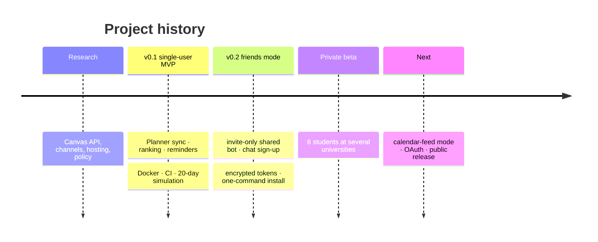

# Documentation

| I want to… | Read |
|---|---|
| **Use** a bot someone invited me to | [Joining guide](guides/joining.md) |
| **Host** a bot for my friends | [Hosting guide](guides/hosting.md) |
| Understand the **rules**: ranking, reminders, quiet hours | [How it works](how-it-works.md) |
| Understand the **code**: components, data, guarantees | [Architecture](architecture.md) |
| See how it's **tested** | [Testing](testing.md) |
| Know what's **stored** and how it's **protected** | [Security](../SECURITY.md) |
| **Contribute** | [Contributing](../CONTRIBUTING.md) |
| Run the **beta checks** on a real deployment | [Beta checklist](guides/beta-checklist.md) |
| Probe my own Canvas with **real data** | [Canvas probe toolkit](../spike/README.md) |

## Design records

These are kept for context. They explain *why* the project looks the way it does.

| Document | What it is |
|---|---|
| [Background research](research/background-research.md) | Canvas data access, notification channels, hosting, security and policy research, written before any code |
| [Product requirements](design/prd.md) | The original spec for the single-user version: goals, rules, UX copy, security model and milestones |
| [Friends-mode design](design/friends-mode.md) | The switch to one shared, invite-only bot with sign-up in the chat |

