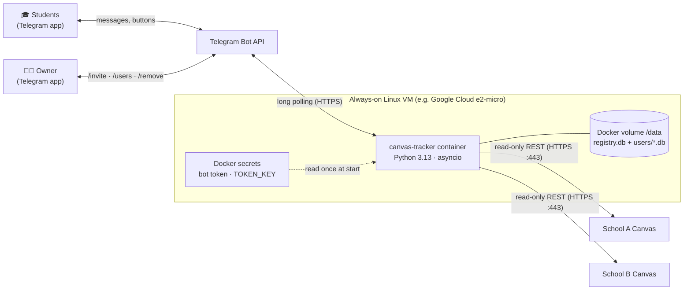
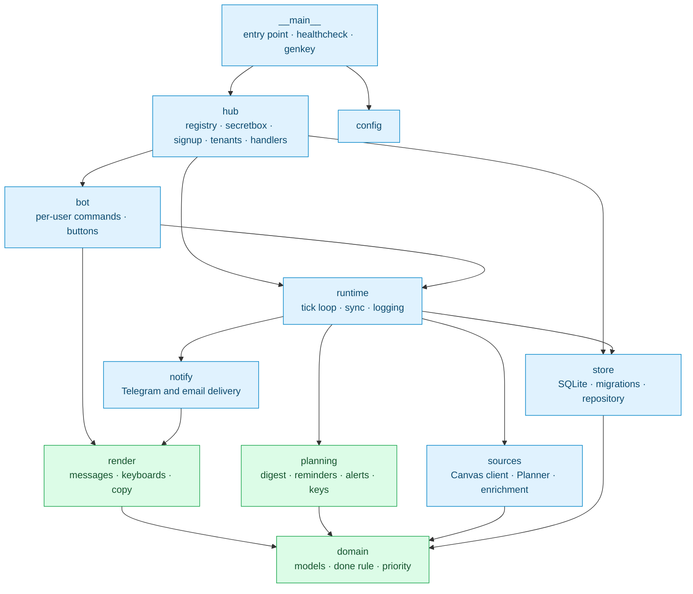
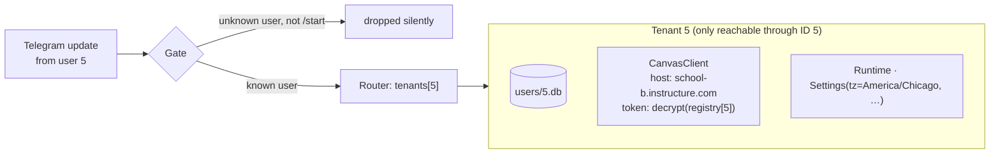
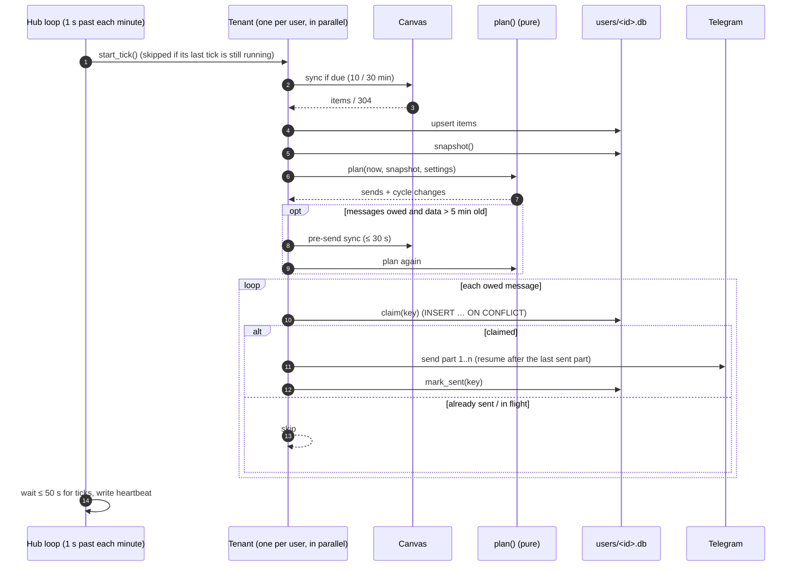
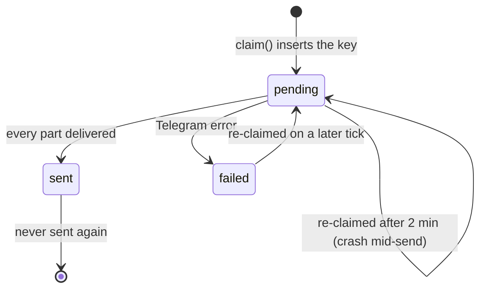
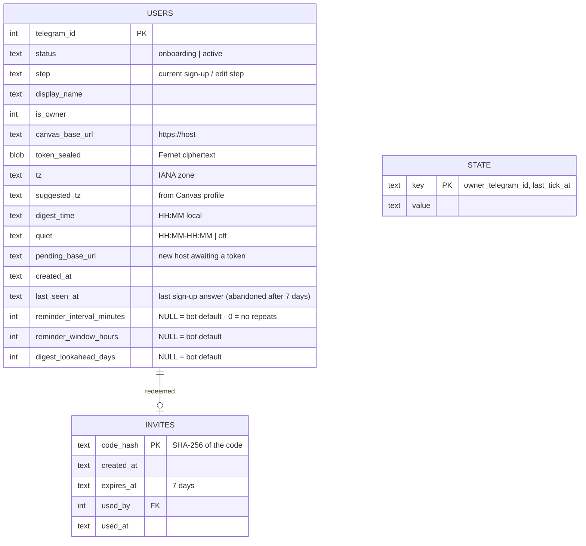
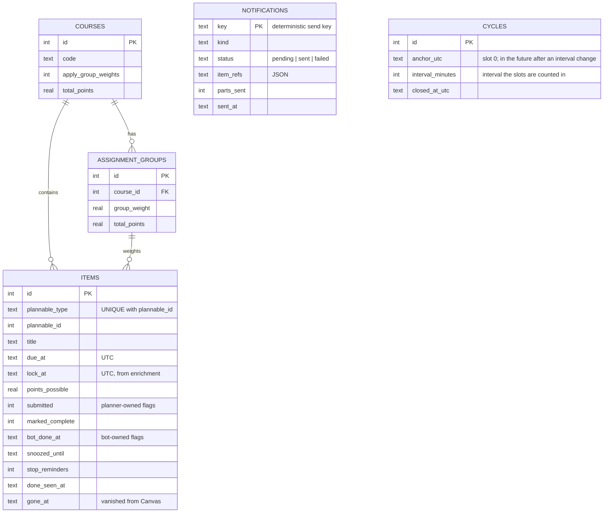

# Architecture

This page describes how the bot is put together: the processes and data stores, how a minute of work flows through them, how sign-up works, what is stored where, and what happens when things fail.

- [1. System context](#1-system-context)
- [2. Packages and dependencies](#2-packages-and-dependencies)
- [3. Multi-user model](#3-multi-user-model)
- [4. One minute in the life of the bot](#4-one-minute-in-the-life-of-the-bot)
- [5. Exactly-once delivery](#5-exactly-once-delivery)
- [6. Sign-up and settings state machine](#6-sign-up-and-settings-state-machine)
- [7. Data model](#7-data-model)
- [8. Concurrency model](#8-concurrency-model)
- [9. Failure modes](#9-failure-modes)
- [10. Configuration](#10-configuration)
- [11. Key decisions](#11-key-decisions)

---

## 1. System context



There's one process and no web server. The bot needs **no inbound ports**: it pulls updates from Telegram and pulls data from Canvas.

## 2. Packages and dependencies



<sub>🟩 pure: no I/O, deterministic, tested exhaustively · 🟦 I/O shell: talks to Canvas, Telegram, SQLite or the clock</sub>

Dependencies point **inward**. `domain` imports nothing from the project, `planning` and `render` only import `domain`, and all I/O sits at the edges. The scheduler is a single pure function:

```python
def plan(now: datetime, snap: Snapshot, settings: Settings) -> Plan: ...
```

It takes the current time, a snapshot of one user's data and that user's settings, and returns which messages are owed. That makes it possible to replay three weeks minute by minute in a test (see [Testing](testing.md)).

| Package | Modules | Responsibility |
|---|---|---|
| `domain` | `models`, `done_rule`, `status`, `priority` | Immutable, UTC-validated value types; the completion rule; the 100-point score |
| `planning` | `plan`, `digest`, `reminders`, `keys`, `timeutil` | When each message is owed; deterministic send keys; DST-safe local-time helpers |
| `render` | `digest`, `alerts`, `views`, `items`, `format`, `message`, `copy` | Message text and keyboards; HTML escaping; 4,096-character splitting; all user-facing strings |
| `sources` | `canvas_client`, `planner`, `enrichment` | Hardened read-only Canvas client; JSON → domain mapping |
| `store` | `db`, `repo`, `migrations/` | SQLite (WAL) per user; send claims; column ownership per data source |
| `runtime` | `loop`, `sync`, `logging` | Minute-aligned tick; sync cadence and error state; JSON logs with redaction |
| `notify` | `base`, `telegram`, `email` | `Notifier` protocol; Telegram delivery with `RetryAfter` handling; SMTP email (stdlib, in a worker thread) |
| `bot` | `commands`, `callbacks`, `pairing`, `deps` | `/today` `/week` `/digest` `/sync` `/status` `/pause`; ✅/💤/↩️/🔕 buttons; owner pairing code |
| `hub` | `hub`, `tenant`, `registry`, `secretbox`, `signup`, `parsing`, `handlers`, `migrations/` | Everything multi-user |

## 3. Multi-user model

Each user is a **tenant**: an object that owns that user's own database file, Canvas client, sync service and scheduler. The **hub** keeps a map from Telegram user ID to tenant.



- Database paths are built from the integer Telegram ID: `DATA_DIR/users/<id>.db`.
- Button callbacks carry only a row ID and that file's random salt (`d:42:9f3a0c1b`). The row is looked up in the **sender's** own file, so a forged or forwarded button can never touch someone else's data. The salt is made when the file is created, so after `/disconnect` and re-joining (a new file whose IDs start again at 1) an old button answers "this button is from before you reconnected" instead of acting on a new item. Buttons sent before salts existed (`d:42`) still work in files that existed then, and are refused by files created later.
- `/users` reads only sync health (last sync, token state) from each tenant, never items, and from the registry only whether an email address is stored (yes/no, never the address).
- `/status` reads the user's own email address through their tenant (`BotDeps.email_address`) and shows it masked.
- `/feedback` sends the owner the sender's display name, Telegram ID, @username and the note itself, never anything from their Canvas. It is limited to 5 delivered notes per user per hour (in memory, like the other rate limits), refuses notes that contain a Canvas token (and deletes that message) and notes over 3,000 characters. The owner's own `/feedback` is only acknowledged.

## 4. One minute in the life of the bot



The heartbeat (`last_tick_at` in `registry.db`) is written every minute even if one tenant is stuck. The container's `HEALTHCHECK` fails if it's more than 3 minutes old.

## 5. Exactly-once delivery

Every message has a **deterministic key** computed from what it's about:

| Message | Key | Sent at most… |
|---|---|---|
| Morning list | `digest:2026-10-20` | once per local date |
| Reminder | `rem:<cycle anchor UTC>:<slot n>` | once per slot of a cycle |
| Just posted | `new:<item>:<due>` | once per item and due date |
| Snooze over | `snz:<item>:<snooze end>` | once per snooze |
| Overnight | `overnight:<local date>` | once per night |
| Overdue | `overdue:<item>:<due>` | once per item and due date |
| Token alert | `auth:<since>` | once per outage |

Before sending, the tenant **claims** the key with one atomic `INSERT … ON CONFLICT DO UPDATE … WHERE` statement:



A crash between delivering a message and recording it can cause at most one duplicate. A long message split into several parts records each part, so a retry resumes after the last part delivered instead of resending the whole thing.

## 6. Sign-up and settings state machine

The conversation state is stored in the registry (`users.step`), so a restart resumes exactly where the user left off. A sign-up that gets no answer for **7 days** (`users.last_seen_at`) is deleted on the next minute's tick, and the person is told to ask for a new invite, so stalled sign-ups don't hold `MAX_USERS` slots. The owner and active users are never removed this way.

```mermaid
stateDiagram-v2
    [*] --> url: /start with a valid invite<br/>(or owner pairing code)
    url --> token: valid public https Canvas host
    token --> tz: token works on Canvas<br/>(message deleted, token sealed)
    tz --> digest: zone resolved<br/>(city, region, IANA name, or Canvas's own)
    digest --> quiet: time ≤ 8 PM
    quiet --> active: quiet hours don't hide the morning list
    active --> active: commands · buttons

    state "settings edits" as edits {
        edit_tz
        edit_digest
        edit_quiet
        edit_token
        edit_url --> edit_token: new host saved as pending
        reminders: ⏰ Reminders menu (no step; each button saves one value)
    }
    active --> edits: /settings → button
    edits --> active: saved (tenant rebuilt) · /cancel · /start
    active --> [*]: /disconnect or /remove (files and row deleted)
```



**Input is forgiving but strict.** Each step accepts many ways of typing the same thing, and refuses anything that isn't valid:

| Step | Accepts | Refuses |
|---|---|---|
| Canvas address | `school.instructure.com`, any Canvas page URL, `https://…:443` | `http`, IP addresses, other ports, `localhost`/`.local`/`.internal`, hosts resolving to private addresses |
| Token | Pasted with stray spaces or newlines | Anything Canvas rejects, or that can't read the To Do list; more than 5 checks in 15 minutes ("wait N min") |
| Time zone | `Chicago`, `Pacific`, `EST`, `Pacific Standard Time`, `Europe/Berlin`, or a button | Unknown names; legacy fixed-offset zones |
| Morning time | `8`, `7:30 am`, `19:00`, `7.45 AM`, or a button | After 8 PM; invalid times |
| Quiet hours | `23:00-07:00`, `11pm - 7am`, `12 am to 8 am`, `off`, or a button | Ranges that would hide the morning list |
| Reminder rhythm (`/settings` only) | Buttons: every 1/2/3/4 h or no repeats, urgent within 12/24/48 h, list of 7/14/21 days | Any other value (an old or forged button just shows the menu again) |

## 7. Data model

Two kinds of SQLite database, each with its own numbered migrations.

**Registry** (`DATA_DIR/registry.db`, one per bot):



**Per-user store** (`DATA_DIR/users/<telegram id>.db`, one per user):



**Column ownership** prevents the three writers from overwriting each other:
- The 10-minute planner sync writes only Canvas planner fields.
- Enrichment writes lock dates, submission types and group IDs.
- Button presses write only the bot's own flags (`bot_done_at`, `snoozed_until`, `stop_reminders`).

A due-date change clears the bot's flags, which is how extensions re-open items. A daily purge drops items more than 30 days past due and notification records older than 60 days.

## 8. Concurrency model

| Concern | Approach |
|---|---|
| Many users | One asyncio event loop. Each tenant's tick is its own task; the hub never waits on a stuck one (bounded wait of 50 s, then skip). |
| Telegram updates | Processed **concurrently** (`concurrent_updates=True`), but serialized **per user** with a lock, so one person's sign-up steps never interleave. |
| Settings change during a tick | Rebuilding a tenant cancels its running tick, closes its client and connection, then starts fresh. A closed tenant never ticks. |
| SQLite | One connection per database, used only from the event loop thread; WAL mode with a 5 s busy timeout. |
| Canvas | One request at a time per tenant (a lock in the client), as Canvas recommends for avoiding throttling. |

## 9. Failure modes

| What fails | What the user sees | What the bot does |
|---|---|---|
| Canvas down or slow | Messages carry a ⚠️ "based on data from…" note | Retries with backoff; each sync bounded to 60 s; other users unaffected |
| Canvas host starts resolving to a private address (DNS rebinding) | Same as Canvas down | The host is re-checked before every sync and token check (a pass is cached for 5 min); while it fails nothing is sent to it and `last_sync_error` is `CanvasHostRefused` |
| Someone spams `/sync` or token attempts | "You just synced, try again in N s" / "wait N min" | `/sync` at most once a minute per user; at most 5 token checks per user per 15 minutes (in memory, reset on restart) |
| Canvas rejects the token | One 🔑 message with steps | Re-checks every 6 h, or immediately after a new token is pasted via `/settings` |
| Telegram rate-limits | A slight delay | Honors `RetryAfter`, then retries the claim on the next tick |
| Crash or restart mid-send | At most one duplicate message | Claims and per-part progress resume the work |
| Server down for hours | A late morning list (up to 4 h); missed reminder slots skipped | Catches up without a burst of messages |
| `TOKEN_KEY` lost or replaced | "Can't read your stored token, paste it again" | Detected at start; the owner is told; nobody gets a false "Canvas rejected you" |
| One user's record broken | That user is asked to contact the owner | Everyone else keeps running |
| Clock change (DST) | Nothing unusual | All schedules are UTC durations; local times are only converted at the edges |

## 10. Configuration

Bot-wide settings come from the environment ([`.env.example`](../.env.example)). Everything per-person is set in the chat.

| Variable | Default | Meaning |
|---|---|---|
| `TELEGRAM_BOT_TOKEN_FILE` | *(required)* | File with the bot token from @BotFather (a Docker secret) |
| `TOKEN_KEY_FILE` | *(required)* | File with the Fernet key that encrypts Canvas tokens (`python -m canvas_tracker genkey`) |
| `OWNER_TELEGRAM_ID` | empty | Owner's Telegram ID; if empty, the owner claims the bot with a one-time code from the log |
| `DATA_DIR` | `/data` | Where `registry.db` and `users/*.db` live |
| `MAX_USERS` | `25` | Sign-up cap (owner included); sign-ups idle for 7 days stop counting |
| `DIGEST_LOOKAHEAD_DAYS` | `14` | How far ahead the morning list looks (default; each user can pick 7, 14 or 21) |
| `REMINDER_WINDOW_HOURS` | `24` | "Due soon" window that starts the reminder cycle (default; users pick 12, 24 or 48) |
| `REMINDER_INTERVAL_MINUTES` | `120` | Time between reminders, minimum 30 (default; users pick 1–4 h or no repeats) |
| `OVERDUE_REMINDERS` · `OVERDUE_REMINDER_MAX_HOURS` | `false` · `48` | Optional reminders after the deadline |
| `ITEM_RETENTION_DAYS` | `30` | Purge items this long past due |
| `LOG_LEVEL` | `INFO` | JSON logs to stdout |

## 11. Key decisions

| Decision | Alternatives considered | Why |
|---|---|---|
| Canvas **Planner API** + personal token | Scraping, iCal feed, GraphQL, OAuth | The only student-accessible source with per-student due dates **and** submission status in one call. iCal is planned as a fallback; OAuth needs each school's admin. |
| **Telegram** | SMS, email, ntfy, Pushover, Discord, WhatsApp | Free, has buttons, works everywhere. US SMS needs paid carrier registration. |
| **Long polling** | Webhooks | No inbound ports, no TLS certificate, works behind NAT. |
| **SQLite file per user** | One shared database with `user_id` columns | Isolation is structural, deletion is `rm`, and the single-user core needed no changes. |
| **Fernet** for tokens | Plaintext + disk encryption, a KMS | Authenticated encryption with zero infrastructure; the key is kept apart from the data. |
| **Pure `plan()`** | Cron-style jobs per message type | One function decides everything, so the whole schedule is testable by simulation. |
| **UTC-anchored cycles** | Wall-clock slots ("every even hour") | Daylight-saving changes can't create, drop or duplicate a reminder. |

The full reasoning is in the design records: the [product requirements](design/prd.md) and the [friends-mode design](design/friends-mode.md).
