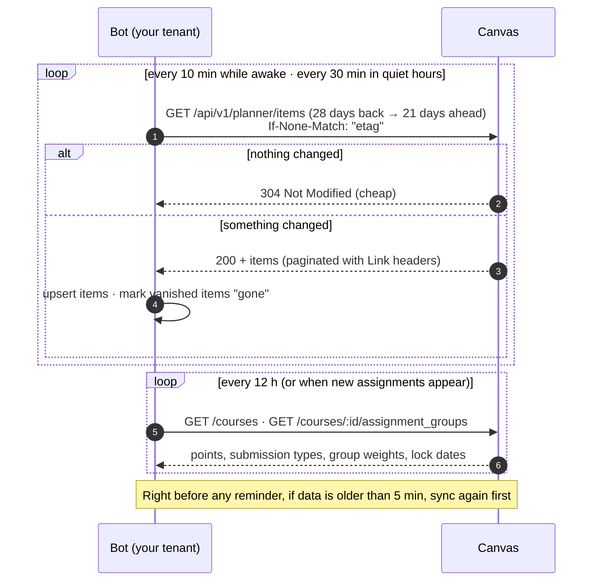
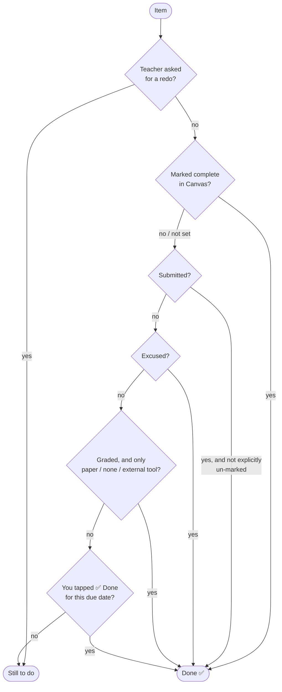
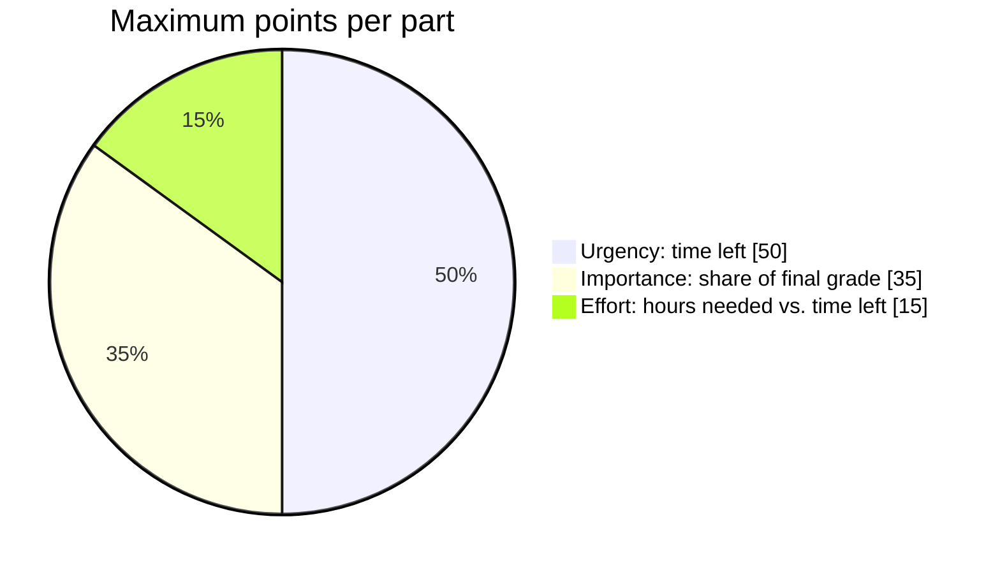
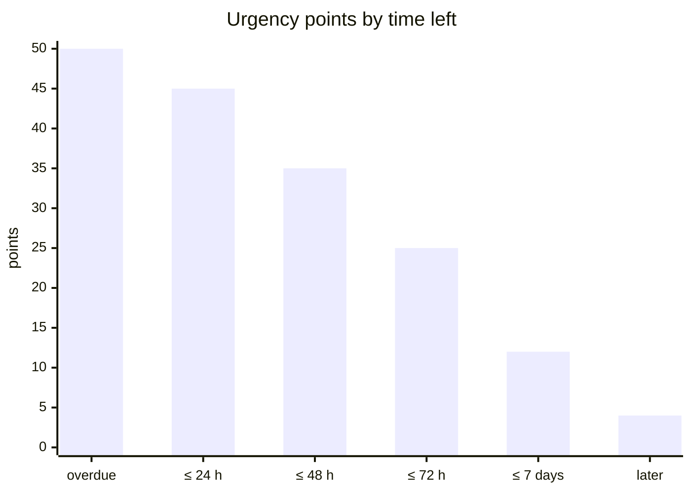
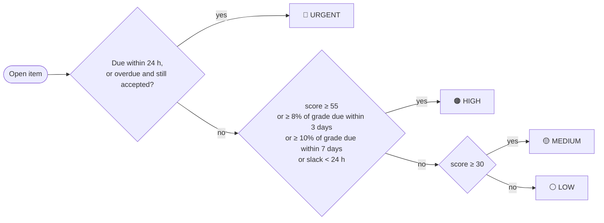

# How it works

This page explains the rules the bot follows: when it checks Canvas, when an assignment counts as done, how it ranks your work, and exactly when each message is sent. The code lives in [`domain/`](../src/canvas_tracker/domain) and [`planning/`](../src/canvas_tracker/planning). Both are pure functions with no I/O, so every rule below is pinned by tests.

- [1. Getting data from Canvas](#1-getting-data-from-canvas)
- [2. When is something "done"?](#2-when-is-something-done)
- [3. Ranking: the 100-point score](#3-ranking-the-100-point-score)
- [4. The morning list](#4-the-morning-list)
- [5. Reminders, hour by hour](#5-reminders-hour-by-hour)
- [6. Quiet hours, snooze, pause and overdue](#6-quiet-hours-snooze-pause-and-overdue)
- [7. When Canvas can't be reached](#7-when-canvas-cant-be-reached)

---

## 1. Getting data from Canvas

The bot uses the same **Planner API** that fills the To Do sidebar in Canvas. One request answers three questions for every course at once: what is due, when, and whether it's already done.

| What | When | Why |
|---|---|---|
| Planner sync | Every **10 min** while awake, **30 min** in quiet hours | A submission shows up within about one interval |
| Pre-send sync | Before any message, if data is more than **5 min** old | Never nag about work you just submitted |
| Enrichment | Every **12 h**, or as soon as an unknown assignment appears | Grade weights and points change rarely |
| ETag | Only when the planner fits on one page | A page-1 ETag can't vouch for later pages |
| Throttling | `429`, or `403` + "Rate Limit Exceeded" → capped exponential backoff with full jitter | Stay well inside Canvas's per-token quota |

The client only ever **reads**. It sends `GET` requests to `/api/v1/` paths on your own Canvas host, refuses redirects and pagination links to other hosts, and identifies itself with a descriptive `User-Agent`, which Canvas requires.

Before every sync (and every token check) the bot re-checks that your Canvas host still resolves only to public addresses; a passing check is reused for 5 minutes. If the host ever starts pointing at a private address, the bot treats Canvas as unreachable and sends it nothing until that changes. A manual `/sync` works at most once a minute (the bot syncs by itself every 10 minutes anyway).

## 2. When is something "done"?

The bot mirrors Canvas's own Planner rule, and tightens it in two places: excused work and offline work.

- **A teacher's zero on online work doesn't hide it.** Missing online work stays visible in the ⚠️ OVERDUE section while Canvas still accepts it.
- **Extensions re-open items.** Your ✅ Done is tied to the due date you tapped it for. If the date moves, the item comes back and any snooze or 🔕 Stop is cleared.
- **Undo** works for 10 minutes after ✅ Done.
- **Old buttons stay harmless.** Each button carries a random code tied to your current data. After `/disconnect` and signing up again, buttons on old messages answer "this button is from before you reconnected" instead of acting on a new item.

## 3. Ranking: the 100-point score

Each open item gets a transparent score out of 100, built from three parts. Every threshold lives in one config object ([`PriorityConfig`](../src/canvas_tracker/domain/priority.py)) so it can be tuned with real use.

### Urgency (0–50): how soon it's due

### Importance (0–35): how much of your grade it's worth

The bot computes each item's **share of the final grade** from Canvas data:
- In a course with weighted assignment groups, share = group weight × item points ÷ group points.
- Otherwise, share = item points ÷ course total points.

| Share of final grade | Points |
|---|---|
| ≥ 15% | 35 |
| ≥ 8% | 28 |
| ≥ 4% | 20 |
| ≥ 1.5% | 12 |
| smaller, or unknown but graded | 6 |
| ungraded or excluded from the final grade | 2 |
| title mentions *exam, midterm, final* or *project* | **+5** (capped at 35) |

### Effort (0–15): will you run out of time?

| Title or type | Estimated effort |
|---|---|
| exam, midterm, final | 8 h |
| essay, project, paper | 6 h |
| lab | 3 h |
| quiz, discussion, peer review, page, reading | 1 h |
| anything else | 2 h |

**Slack** = hours left − 1.5 × estimated hours. It's worth **15** points if slack ≤ 0, **10** if ≤ 24 h, **5** if ≤ 72 h, and **0** otherwise. High-tier items also show a **"start by"** time, due date − 1.5 × effort, so you know when to begin.

### Tiers

### Worked example (the morning list in the README preview)

| Item | Time left | Urgency | Share | Importance | Effort (slack) | Total | Tier |
|---|---|---|---|---|---|---|---|
| CS 101 · Homework 4 | 15 h | 45 | 4% | 20 | 2 h (12 h) → 10 | **75** | 🔴 URGENT (due < 24 h) |
| HIST 210 · Essay draft | 2 days | 35 | 12% | 28 | 6 h (39 h) → 5 | **68** | 🟠 HIGH |
| MATH 221 · Quiz 7 | ~2.7 days | 25 | 8% | 28 | 1 h (63 h) → 5 | **58** | 🟠 HIGH |

Within a section, items are ordered by due date, then by score.

## 4. The morning list

Each user gets one list per day at the time they choose (any time up to 8 PM), with a same-day catch-up window of 4 hours in case the server was down. It is keyed by the local date, so restarts and clock changes can't send it twice.

| Section | Contents |
|---|---|
| Header | Date, counts per tier, time of the last successful sync |
| ⚠️ Stale banner | Only if Canvas couldn't be reached recently |
| 🔴 URGENT · 🟠 HIGH | Numbered, each with a ✅ button and a one-line "why" (due, share, type, effort, start-by) |
| 🟡 MEDIUM / ⚪ LOW | A single summary line with the next three items, pointing to `/week` |
| ⚠️ OVERDUE | Work past due that Canvas still accepts, with the "accepted until" date |
| 📢 Announcements & events | Calendar events today, and announcements from the last 24 hours that weren't already sent on their own. Shown with links, never ranked, reminded or marked overdue |
| ✅ Done yesterday | Count of items finished yesterday |

## 5. Reminders, hour by hour

While **anything** is due within 24 hours and not done, the bot runs a **reminder cycle**. That's one combined message every 2 hours, listing every urgent item, nearest first. The cycle's slots are measured in fixed durations from the moment it opened, so a daylight-saving change can't shift or duplicate them.

Those are the defaults. Each person can choose their own rhythm in `/settings → ⏰ Reminders`:

| Setting | Choices | Default |
|---|---|---|
| Repeat | every 1, 2, 3 or 4 hours, or **no repeats** | 2 hours |
| Counts as urgent | due within 12, 24 or 48 hours | 24 hours |
| Morning list covers | the next 7, 14 or 21 days | 14 days |

(The owner sets the defaults with `REMINDER_INTERVAL_MINUTES`, `REMINDER_WINDOW_HOURS` and `DIGEST_LOOKAHEAD_DAYS`; people who never open the menu follow them.)

- **Changing the interval mid-cycle** restarts the cycle from its latest slot, so nothing is sent twice and nothing is skipped: the next reminder comes on the new spacing after the last one, or when it was already planned if that is sooner. A slot that was due at that moment but not sent yet still goes out once.
- **No repeats** keeps the morning list and every one-off message below. The 🆕 alert then covers work posted after the morning list and due before the next one, once per item. A cycle that was open stays open quietly, so switching repeats back on continues the old rhythm instead of reminding again at once.

Example: *Homework 4* is due Tuesday at 11:59 PM; the student's quiet hours are 12–8 AM and their morning list is at 8 AM. They submit at 7:40 PM.

```mermaid
gantt
    title Tuesday for one student (morning list 8 AM, quiet hours midnight to 8 AM)
    dateFormat HH:mm
    axisFormat %H:%M
    todayMarker off
    section Quiet hours
    No messages                     :crit, q1, 00:00, 8h
    section Morning list
    ☀️ Ranked list (Homework 4 is URGENT) :milestone, d1, 08:00, 0m
    section 2-hourly reminders
    ⏰ Reminder 1                  :milestone, r1, 09:59, 0m
    ⏰ Reminder 2                  :milestone, r2, 11:59, 0m
    ⏰ Reminder 3                  :milestone, r3, 13:59, 0m
    ⏰ Reminder 4                  :milestone, r4, 15:59, 0m
    ⏰ Reminder 5                  :milestone, r5, 17:59, 0m
    section Canvas
    Student submits                 :active, s1, 19:40, 10m
    Next sync sees it, cycle closes :milestone, c1, 19:50, 0m
```

- The cycle opened Monday at 11:59 PM, when the homework entered the 24-hour window. Slots fall at 11:59 PM, 1:59 AM, 3:59 AM and so on.
- Slots inside quiet hours (1:59, 3:59, 5:59, 7:59) are **skipped, not delayed**. A slot within 15 minutes of the morning list is folded into the list.
- A missed slot (for example, the server was down) is sent at most **30 minutes** late, and otherwise skipped.
- After the 7:40 PM submission, the next sync sees `submitted: true`, the homework drops out, and with nothing else urgent the cycle closes. No 7:59 PM reminder is sent.

**Other one-off messages**

| Message | When |
|---|---|
| 🆕 *Just posted and due soon* | New work that's due before the next reminder slot (it would otherwise be missed); with no repeats, before the next morning list. Not sent when a *Snooze over* message for the same item goes out |
| 🌙 *Due while you sleep* | 30 minutes before quiet hours start, if anything is due during them |
| ⏰ *Snooze over* | When a 💤 snooze ends and the item is still open |
| 📢 *New announcement* | Once per course announcement, when it's posted (after quiet hours or `/pause`). Posted overnight, it only appears in the morning list. Only an 🔗 Open button: there's nothing to submit |
| 📅 *Event at …* | One heads-up an hour before a calendar event starts |
| ❗ *Now overdue* | **Once**, within 2 hours after the deadline. It says whether Canvas still accepts the work. Never for announcements or events |
| 📧 *Email: morning list* | Only with `/email` on: a copy of the morning list, in the same window as the Telegram one |
| 📧 *Email: due in 2 hours* | Only with `/email` on: one email per deadline, 2 hours before it; items due at the same instant share one email. Waits out quiet hours and `/pause`; never sent after the deadline or for work that's done, stopped or gone |
| 🔑 *Canvas rejected your token* | Once, when the token stops working, with steps to replace it via `/settings` |

## 6. Quiet hours, snooze, pause and overdue

- **Quiet hours** (default 12–8 AM, or off) may wrap past midnight. Nothing is sent during them, except the overnight warning, which comes just before they start.
- **💤 Snooze** hides an item for 2 hours, but never past 30 minutes before its deadline. It can't be used once less than 30 minutes remain.
- **`/pause`** silences reminders for up to 7 days (`30m`, `3h`, `until 18:00`, `off`). The morning list still arrives.
- **🔕 Stop** on an overdue item ends all messages about it.
- **Overdue** items get one notice, then stay listed in the morning list's OVERDUE section for 7 days, or until Canvas stops accepting them.

## 7. When Canvas can't be reached

The bot never presents old data as current:

- If the pre-send sync fails and the data is more than 5 minutes old, every reminder carries *"⚠️ Based on Canvas data from 1:00 PM. If you've already submitted, ignore this."*
- The morning list shows a ⚠️ banner and **never** says "Nothing due 🎉" when it couldn't check.
- `/status` shows the last successful sync and whether the token works, plus the next morning list and reminder, the reminder rhythm, whether email is on (the address masked, like `m***@school.edu`), when the next 📅 event heads-up goes out and when the latest announcement was posted.
- A token Canvas explicitly rejects (`401` with `WWW-Authenticate`) triggers one 🔑 alert, then a re-check every 6 hours or as soon as a new token is pasted. A `401` without that header, for example a course you can't see, is just skipped.
- If a person's Canvas keeps failing for another reason (it can't be reached, or answers in a way the bot doesn't understand) for 6 hours, the person who runs the bot gets one ⚠️ message with that person's name and Telegram ID (never their assignments), and a ✅ when it works again.
