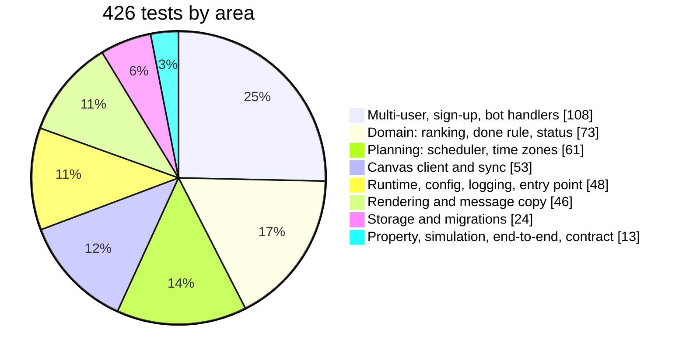
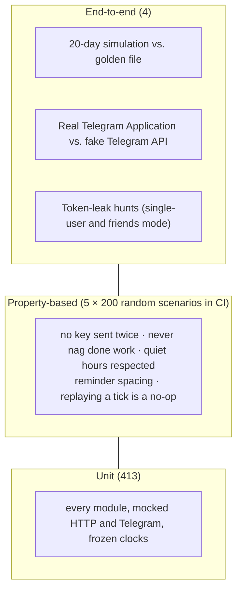

# Testing

A reminder bot fails in ways that are hard to notice: a duplicate message at 3 AM, a deadline that slips through a daylight-saving change, or a nag about work you already submitted. The test suite is built to catch exactly those cases.

| | |
|---|---|
| **426** tests | 424 pass, 2 skip (contract tests that wait for scrubbed real Canvas data) |
| **94%** line + branch coverage | CI fails below 85% overall, or below **95%** on `domain` + `planning` (currently 98%) |
| **`mypy --strict`** | 0 errors across all source and test files |
| **Ruff** | 11 rule families, including Bandit security rules, async pitfalls and naive-datetime checks |
| CI | Python **3.13 and 3.14**, plus `pip-audit` and a Docker build, on every push |

## Test layers





### Unit tests: `tests/unit/`

Every module has its own test file. External services are faked at the boundary:

- **Canvas:** `respx` and `httpx.MockTransport` serve canned JSON, including 304s, 401s with and without `WWW-Authenticate`, 403 "Rate Limit Exceeded", 503s, HTML login pages, redirects and cross-host `Link` headers.
- **Telegram:** real `python-telegram-bot` `Update` objects around a mocked `Bot`, so handlers run exactly as in production.
- **Time:** `time-machine` and injected clocks. No test depends on the wall clock.

### Property-based tests: `tests/property/`

[Hypothesis](https://hypothesis.readthedocs.io/) generates random scenarios: random items, due dates, time zones, quiet hours, submission times and pauses. It runs the real scheduler every 10 minutes over **3 simulated days**, then checks five invariants:

| Invariant | Meaning |
|---|---|
| `test_no_key_is_sent_twice` | Every message is sent at most once |
| `test_never_nags_about_done_or_past_due_work` | Submitted, excused or done work is never in a reminder |
| `test_nothing_but_digest_and_overnight_inside_quiet_hours` | Quiet hours are really quiet |
| `test_active_items_are_reminded_at_least_every_interval` | No urgent item is silently forgotten |
| `test_replaying_any_tick_is_a_no_op` | A crash and re-run of the same minute changes nothing |

Each property was checked by deliberately breaking the scheduler (dropping the quiet-hours check, forgetting sent keys, nagging done items, 4-hour slots) and confirming the property fails.

### Simulation: `tests/integration/test_simulation.py`

The real `Runtime`, `SyncService`, Canvas client and SQLite store run against a fake Canvas, **minute by minute for 20 days** (about 28,800 ticks), across the **November 1 US daylight-saving change**. The scenario includes:

- weekly homework due Tuesdays at 11:59 PM;
- an assignment submitted mid-cycle;
- an extension granted halfway through;
- work posted 40 minutes before its deadline;
- graded paper work;
- something due at 3 AM;
- something due on the night the clocks change.

Every message is compared with a hand-reviewed **golden file** (`tests/integration/golden/simulation.txt`). Any change in behaviour shows up as a readable diff:

```text
Mon 10-26 08:00 digest digest:2026-10-26
Mon 10-26 23:59 reminder rem:2026-10-27T03:59Z:0
Tue 10-27 08:00 digest digest:2026-10-27
Tue 10-27 09:59 reminder rem:2026-10-27T03:59Z:5
…
```

### Security tests

| Test | What it proves |
|---|---|
| `test_secrets_never_leak` | Sentinel Canvas and Telegram tokens, pushed through 30 ticks including 401s and 503s that **echo the token back**, never appear in logs, sent messages, or the bytes of any database file, even with HTTP debug logging turned on |
| `test_pasted_token_never_leaks` | The same for friends mode: a token pasted into the chat during sign-up |
| `test_friends_only_see_and_touch_their_own_items` | Two users with different Canvas data; neither's commands or buttons can see or change the other's items |
| `test_a_token_pasted_at_any_step_is_deleted` | Tokens pasted at the wrong time are still removed from the chat |

The leak tests were each proven able to fail: storing the token unencrypted, or turning redaction off, makes them fail.

### Application wiring: `tests/integration/test_app_wiring.py`

The real `telegram.ext.Application`, with every handler registered as in production, runs against a **fake Telegram Bot API**. It walks the whole journey:
1. A stranger is ignored.
2. The owner signs up through messages and buttons.
3. The owner sends `/invite`, and a friend joins with the link.
4. Per-user commands, `/settings` and the owner commands run.
5. The friend sends `/disconnect`.

### Contract tests: `tests/contract/`

The contract tests run the Canvas parsers against **real Canvas responses**, captured with the owner-run probe in [`spike/`](../spike) and scrubbed of personal data. They skip until those fixtures are committed. A companion test fails if any committed fixture still contains a token, an email or a calendar-feed URL.

## Coverage by package

| Package | Coverage | |
|---|---|---|
| `notify` | 100% | ██████████ |
| `domain` | 99.5% | ██████████ |
| `store` | 99.2% | ██████████ |
| `render` | 97.7% | ██████████ |
| `planning` | 96.6% | ██████████ |
| `sources` | 95.9% | ██████████ |
| `runtime` | 94.0% | █████████▍ |
| `hub` | 91.4% | █████████▏ |
| `bot` | 91.1% | █████████▏ |
| entry point and config | 86.6% | ████████▋ |
| **Total** | **94%** | █████████▍ |

<sub>Line + branch coverage (`coverage.py` with `branch = true`). The entry point's `run()` wires real Telegram networking and is covered by the wiring test instead.</sub>

## Running the tests

```sh
uv sync                                   # install everything, including dev tools
uv run pytest                             # full suite (~5 min, includes the 20-day simulation)
uv run pytest -m "not slow"               # fast suite (~25 s)
uv run pytest tests/unit/test_priority.py # one file
HYPOTHESIS_PROFILE=ci uv run pytest tests/property   # 200 examples per property, as in CI
uv run pytest --cov --cov-report=term-missing        # with coverage
```

If behaviour changes on purpose, regenerate the simulation golden file, then **read the diff before committing it**:

```sh
uv run pytest tests/integration/test_simulation.py --update-golden
git diff tests/integration/golden/simulation.txt
```

The same checks CI runs:

```sh
uv run ruff check && uv run ruff format --check && uv run mypy src tests && uv run pytest && uv run pip-audit
```
