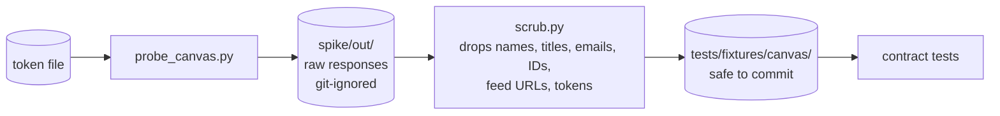

# Canvas probe toolkit

Small, owner-run scripts that check how **a real** Canvas instance and Telegram behave. They answer the open questions S1–S8 in the [product requirements](../docs/design/prd.md) (§17), and produce **scrubbed** sample data for the contract tests in [`tests/contract/`](../tests/contract).

> [!CAUTION]
> Run these on your own computer, against your own account. Secrets are read from files you pass with `--token-file` / `--feed-file`, never from command-line arguments. Never paste tokens into a chat, an issue or a commit.

## Scripts

| Script | Answers | Example |
|---|---|---|
| `probe_canvas.py` | S3–S7: token expiry visibility, profile time zone, assignment-group JSON, planner overrides, ETag/304 behaviour | `uv run python spike/probe_canvas.py --base-url https://school.instructure.com --token-file ~/canvas_token.txt` |
| `probe_ical.py` | S1: does submitted work leave the calendar feed? How do 23:59 and all-day dates look? (run before **and** after submitting) | `uv run python spike/probe_ical.py --feed-file ~/canvas_feed_url.txt` |
| `probe_telegram.py` | S8: HTML escaping, the 4,096-character limit, silent messages, editing a keyboard after a tap | `uv run python spike/probe_telegram.py --token-file ~/bot_token.txt --chat-id 123456789` |
| `scrub.py` | Makes raw output safe to commit | `uv run python spike/scrub.py --host school.instructure.com spike/out tests/fixtures/canvas` |

- **S2** (when a New Quiz counts as submitted) is manual: submit a New Quiz, run `probe_canvas.py` again, and look at that item's `submissions` in `spike/out/planner_items.json`.
- `probe_telegram.py` reads updates itself, so **stop the bot first** (`sudo docker compose stop`) or the two will compete for button presses.
- Your Telegram chat ID: message **@userinfobot**.

## Scrubbing

`scrub.py` only copies `planner_items*.json` and `assignment_groups_*.json`. Your profile and token list never leave `spike/out/`. It:
- removes tokens, emails, names, assignment titles and free-text bodies, keeping the JSON structure;
- replaces calendar-feed URLs;
- swaps IDs on person-shaped objects for fakes;
- rewrites your school's host to `canvas.example.edu`.

**Check the result by eye before committing.** The test `tests/contract/test_fixtures_clean.py` also fails if a committed fixture still contains anything token-, email- or feed-shaped.

## Findings

Fill this in after a run and commit it with the scrubbed fixtures.

| # | Question | Result | Evidence (fixture file) |
|---|---|---|---|
| S1 | Do submitted assignments disappear from the calendar feed? How do 23:59 and all-day due dates appear? | | |
| S2 | When does a New Quiz set `submitted` / `submitted_at`? | | |
| S3 | Can the token read its own `expires_at` through the API? | | |
| S4 | Does the profile expose a time zone? | | |
| S5 | Exact `assignment_groups` JSON (`group_weight`); REST or GraphQL for weights? | | |
| S6 | Does `planner_override.marked_complete` behave as the source suggests? | | |
| S7 | Does a planner ETag poll return 304? How fast does a submission show up? | | |
| S8 | Telegram: `disable_notification`, 4,096-character limit, editing keyboards | | |
